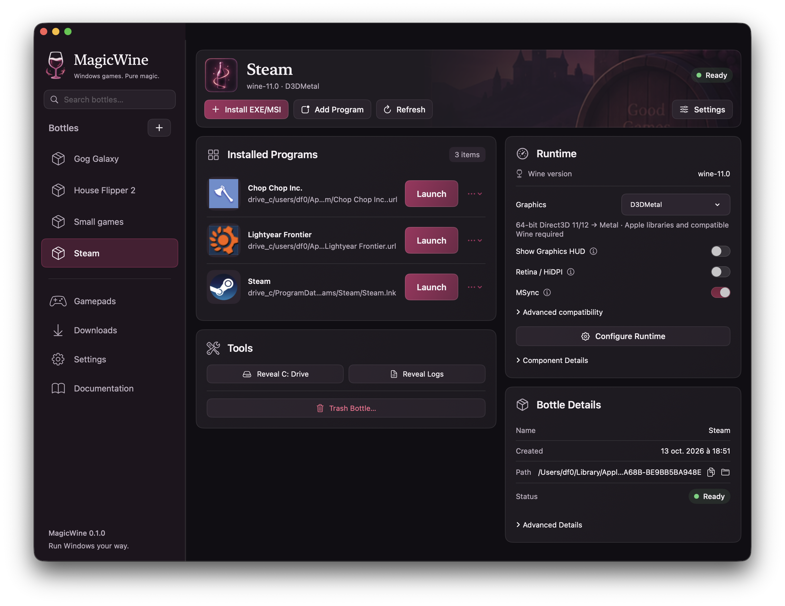

> ⚠️ **Research project**
>
> This repository is a research project for people who want to make their specific Windows game work on macOS. It is not intended as a general-purpose gaming solution. For everyday use, I strongly recommend [CrossOver](https://www.codeweavers.com/crossover).

# MagicWine

A native SwiftUI app for experimenting with Windows games on macOS using Wine. It manages separate Windows environments (bottles), game launchers, graphics backends, and controllers. Compatibility varies by game; expect debugging and source changes.



## Build and run

Requires macOS 14 or newer and Swift 6 developer tools (Xcode or Apple's Command Line Tools). Intel Wine requires Rosetta on Apple Silicon.

```sh
./scripts/build-app.sh
open dist/MagicWine.app
```

This creates an ad-hoc-signed development build, not a notarized release. The CLI is `dist/magicwine`; keep `dist/MagicWine_MagicWineCore.bundle` beside it.

## Try a game

1. In **Downloads**, choose **Install / Update Wine…** and review the unsigned-runtime trust confirmation.
2. Create a bottle with **+**.
3. Use **Install EXE/MSI** to run an installer, or **Add Program** to select an existing launcher.
4. Launch the program. Experiment with the bottle's graphics settings as needed: Standard, DXVK, DXMT, or locally imported D3DMetal.

Wine downloads separately; compatibility components ship with the app. D3DMetal is proprietary, is not bundled, and requires a legally obtained local installation under its own terms. MagicWine is not affiliated with CodeWeavers, Apple, or the Wine project.

**A bottle is not a security sandbox.** Windows programs run with your macOS user's permissions. Only run software you trust, and review logs for personal paths before sharing them.

## Development

- [Technical documentation](docs/README.md): architecture, runtime lifecycle, graphics, compatibility patches, controllers, and debugging.
- `Sources/`: Swift app, core library, CLI, and native gamepad bridge.
- `patches/` and `scripts/`: runtime patches, build recipes, and verification tools.
- Run `./scripts/test.sh` for Swift tests; Wine integration runners are in `scripts/test-*.sh`.
- See [CHANGELOG.md](CHANGELOG.md) for research history and compatibility work.

## License

MagicWine's current original source is [MIT-licensed](LICENSE), except files with an explicit different license. Bundled components retain their own terms, including LGPL Wine code and the previously GPL-licensed XInput v1 binaries/source archive. See [THIRD_PARTY_NOTICES.md](THIRD_PARTY_NOTICES.md) for license boundaries and corresponding sources.
