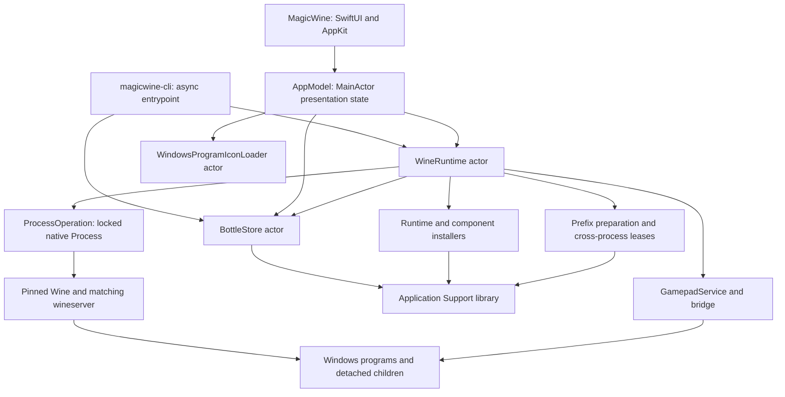

# Architecture and ownership

[Documentation index](README.md) · [Runtime lifecycle](runtime-lifecycle.md)

MagicWine is a native macOS bottle manager and research integration layer around Wine. It is not a Windows virtual machine, a security sandbox, or a guarantee that a particular application will work. A **bottle** combines a Wine prefix, a pinned runtime descriptor, launchers, and bottle-wide settings. Windows software still runs with the host user's privileges.

## Modules and execution boundaries

[`Package.swift`](../Package.swift) declares Swift 6 tooling, macOS 14 as the package deployment minimum, and three products:

| Product / target | Owns | Does not own |
| --- | --- | --- |
| `MagicWine` | SwiftUI/AppKit interface, consent dialogs, selection, presentation state, file-open handling | Wine implementation or authoritative on-disk bottle state |
| `MagicWineCore` | Models, persistence, runtime installation and execution, prefix/component integration, controller service, shortcut and icon parsing | A blanket compatibility promise or system-wide security policy |
| `magicwine-cli` / `MagicWineCLI` | Async command dispatch, arguments, textual results and exit status | The GUI's selection, activity state, or preferred-runtime workflow |



[`AppModel`](../Sources/MagicWine/AppModel.swift) is `@MainActor`: published state, dialogs and UI updates belong there. Its tasks await core actors rather than synchronously waiting for child processes. Progress callbacks are explicitly delivered to the main queue and checked against an operation UUID so a late callback cannot update a newer installation/setup. [`Main.swift`](../Sources/MagicWineCLI/Main.swift) instead builds its own `ApplicationPaths`, one `BottleStore`, and a `WineRuntime` constructed with that store, and awaits the same core operations. Each process creates exactly one `BottleStore` per library and passes it to `WineRuntime.init(paths:store:)`, so actor serialization spans every owner of the library's bottle metadata.

`WineRuntime` is an actor, but actor isolation alone is not an operation-wide mutex: methods suspend and other requests can enter. It therefore also tracks active processes, pending launches, settings mutations, and installation guards. `BottleStore` serializes calls within a process, but the app and CLI are separate processes (and tests may open further instances), so bottle metadata transitions also take the filesystem bottle lock. [`GraphicsOperationLease`](../Sources/MagicWineCore/GraphicsOperationLease.swift) uses nonblocking `flock` with cancellation-aware async waits, while prefix mutations use the bottle lock in `GraphicsPrefix`.

[`ProcessOperation`](../Sources/MagicWineCore/ProcessOperation.swift) confines Foundation `Process` behind an `NSLock`, starts it on a global queue, and returns through a checked continuation. It does not block an actor waiting for termination. File work is not universally detached: core actors perform some synchronous validation and persistence. Large archive hashing is explicitly moved to a cancellable utility task. Controller discovery has its own main-actor requirements; see [controllers](controllers.md).

## Persistent library

[`ApplicationPaths`](../Sources/MagicWineCore/Models.swift) defaults to `~/Library/Application Support/MagicWine`. CLI `--root <directory>` must precede the command and selects a different library; it is not a runtime-selection flag.

```text
MagicWine/
├── settings.json
├── Bottles/
│   ├── .graphics-locks/<bottle-UUID>{,-launch,-lifetime}.lock, storage-cleanup.lock
│   └── <bottle-UUID>/
│       ├── bottle.json
│       ├── prefix/
│       │   ├── drive_c/
│       │   ├── dosdevices/
│       │   ├── system.reg
│       │   └── user.reg
│       └── graphics/                 # backend state and caches, when used
├── Runtimes/
│   ├── wine-11.0_1-b50dc50ec7f4-winemac-wine11.0-metal.7/
│   │   ├── installation.json
│   │   └── Wine Stable.app/Contents/Resources/wine/
│   └── .graphics-views/<receipt-digest>/  # private Metal runtime views
├── Components/                       # managed/imported graphics components
└── Logs/
    ├── Bottles/<UUID>/               # one bottle's process logs; dxvk/, dxmt/ backend logs
    └── Library/                      # Wine/component installs, failed version inspections
```

This is the principal layout, not an exhaustive list of controller, compatibility, or transaction files. Graphics state is described in [graphics](graphics.md); controller persistence in [controllers](controllers.md). Installers stage into temporary `.install-<UUID>` (and `.d3dmetal-<UUID>`) directories under `Runtimes`, `Components` or `.graphics-views` and remove them on exit. Logs are the one category MagicWine prunes by itself ([`ProcessLogs`](../Sources/MagicWineCore/ProcessLogs.swift): newest 50 per folder within 256 MiB, never a log still being written); older flat `Logs/*.log` files from earlier versions stay in place under the same policy. See [debugging](debugging.md#4-inspect-the-right-evidence).

Nothing in normal operation deletes a runtime, component, private view, or lock file: an old managed Wine stays for bottles pinned to it, a replaced component stays until no bottle needs it, and any change to the runtime or component files a view records (including metadata such as a re-consented quarantine removal) produces a new view next to the old one. [`StorageCleanup`](../Sources/MagicWineCore/StorageCleanup.swift) (CLI `cleanup`, **Downloads › Storage**) computes what nothing references from the bottles' pinned runtimes and component IDs, `settings.json`, and the exact view identities launch would use, and removes only entries confirmed from that plan while every bottle is idle. It never touches `Bottles/<UUID>/`; see [runtime lifecycle](runtime-lifecycle.md#reclaiming-storage) for the rules.

Names are display metadata, never directory paths. `BottleStore` trims names and permits 1–80 characters; UUIDs identify bottles and launchers. A bottle stores creation time, its `RuntimeDescriptor` (executable URL and reported version), initialization status, program list, graphics configuration, MSync preference, display preference, and compatibility switches (Rosetta AVX advertising, Wine debug output, DXVK HUD preset). New defaults are Standard graphics, MSync enabled, Retina enabled at 192 DPI, AVX advertising off, quiet Wine debug output, and the detailed DXVK HUD. Legacy records without graphics/MSync/display/compatibility fields receive compatibility defaults; absence of explicit display metadata is retained internally so normalization can be handled deliberately.

`settings.json` holds custom Wine and preferred Wine paths. It does **not** override the runtime already recorded in a bottle. Metadata writes use atomic replacement. Loading checks UUID agreement and directory/metadata ownership, and rejects unsafe links; one malformed bottle can fail listing rather than being silently omitted. General `save` refuses runtime, graphics, display, synchronization, initialization, or compatibility-switch changes, and changes to an existing program's name or launch options: those belong to the validated `WineRuntime` transitions (including `WineRuntime.initialize`, the only way a bottle becomes initialized), `BottleStore.setCompatibility`, and `BottleStore.updateProgram`, not arbitrary model editing. See [`BottleStore.swift`](../Sources/MagicWineCore/BottleStore.swift).

## Launchers, shortcuts, and icons

A `WindowsProgram` stores a UUID, a display name, a filesystem path, and optional launch options (arguments, working directory, environment variables, DLL overrides; see [runtime lifecycle](runtime-lifecycle.md#per-program-launch-options)). Registering an EXE/LNK/URL file does not copy or install it. Removing a launcher only removes metadata. Paths may refer outside the bottle, which matters when moving or deleting a library.

Discovery scans shared Start Menu programs and relevant user Desktop/Start Menu folders for `.lnk` and `.url` files, skips symbolic links and uninstall-named candidates, sorts candidates deterministically, and deduplicates launch identities. It does not enumerate every EXE in `Program Files`. [`WindowsShortcut`](../Sources/MagicWineCore/WindowsShortcut.swift) supplies identity and local icon-source resolution; Wine remains responsible for actually executing shortcuts (`start /unix`).

[`BottleDesktop`](../Sources/MagicWineCore/BottleDesktop.swift) prepares real per-profile Desktop directories before launching Wine or scanning shortcuts. If Desktop is a symbolic link, it removes the link itself, never copies, enumerates or deletes its host target. This prevents installer shortcuts being placed on the macOS Desktop; it does not turn the prefix into a sandbox.

[`WindowsProgramIconLoader`](../Sources/MagicWineCore/WindowsProgramIconLoader.swift) reads local ICO/PE icon data without launching Wine or changing the bottle. Its actor owns a 256-entry `NSCache`, keyed by source and icon index and invalidated by size/mtime changes, including negative results. It decodes thumbnails up to 76 pixels rather than arbitrary full-sized bitmaps. Missing/unreadable icons are presentation failures, not launcher failures.

## Busy is not the same as running

`BottleActivity.title` describes an exclusive UI operation, such as installation, initialization, configuration, or discovery. `runningLaunches` tracks independent launch tasks. A long-lived launcher in the Windows tray must not prevent clicking another program or reopening the launcher, so the UI permits additional launches while that set is nonempty. `isStopping` is separate again.

The UI names three gates as predicates on `BottleActivity`: `blocksLaunch` (exclusive operation or Stop in progress), `blocksLibraryEdit` (the same; Refresh, Add Program, Edit Program, Remove from MagicWine, Reload Bottles), and `blocksPrefixMutation` (those plus running programs; graphics, MSync, Retina, installers, Wine update, winecfg, Trash). Library edits only rewrite `bottle.json` and read shortcut files under the bottle lock, so a tray-resident Steam does not stop new games from being discovered. Discovery's `BottleDesktop.prepare` is a no-op once a launch has prepared the prefix's Desktop directories.

These are **UI observations**, not an authoritative process inventory. An EXE may spawn a child and exit; a separate CLI process may launch Wine; a shortcut may return before its target exits. Core operations therefore consult leases and the prefix's real `wineserver`, not just UI activity. Shortcut launch waits on `wineserver -w`; ordinary EXE launch observes its direct Wine process. The exact handoff, stop, timeout and mutation rules are in [runtime lifecycle](runtime-lifecycle.md).

## Packaged resources and trust

The core target copies exact binary/source/license/provenance resources rather than treating them as UI assets: controller DLLs, DXVK and DXMT archives, compressed patched Wine modules and matching server, and the WoW64 CPU repair DLL. The GUI processes its own `Assets` separately. Code accesses core resources through `Bundle.module`; the executable alone is not a complete deployable artifact. See [development](development.md) for packaging/build recipes.

[`WineMetalDriver`](../Sources/MagicWineCore/WineMetalDriver.swift) verifies compiled-in digests for compressed images, decompressed images, source, license and provenance. It replaces modules only inside a fresh managed staging tree, retaining validated originals and accompanying material under `runtime-compatibility/<component-ID>` in the Wine runtime. It does not patch an arbitrary user-selected Wine installation. Resource/source/license boundaries are substantive: locally obtained Apple D3DMetal libraries are not bundled or downloaded, and experimental-backend consent does not accept their license. See [graphics](graphics.md).

Shared validation primitives live in [`SecureFS`](../Sources/MagicWineCore/SecureFS.swift) (no-follow `lstat`/`O_NOFOLLOW` checks, bounded streaming SHA-256 that rejects files changed while read, inode/mtime/ctime stamps with the process-local adoption cache, exclusive `renamex_np(RENAME_EXCL)` publication, quarantine preservation), [`MachOInspector`](../Sources/MagicWineCore/MachOInspector.swift) and [`PEInspector`](../Sources/MagicWineCore/PEInspector.swift) (header-only binary inspection; never loads code). [`BundledArchive`](../Sources/MagicWineCore/BundledArchive.swift) is the shared copy/hash/member-check/extract stage of the DXVK and DXMT installers. Each component passes its own size limits, hard-link tolerance, builtin-marker requirement and error prefix, so these helpers centralize mechanics, not policy; new installers and compatibility code should reuse them rather than add private copies.

A SHA-256 match proves agreement with a pin, not that software is safe. Managed Wine installation requires explicit permission to run unsigned third-party code and remove quarantine inside the managed Wine app only; it does not disable Gatekeeper. Inspecting a custom runtime executes its `--version`, so selecting an executable is itself a trust decision. Windows software and custom wrappers can access user files and escape intended prefix conventions; environment cleanup is configuration isolation, not hostile-code containment.

## Adding a graphics backend

Backend-specific wiring lives in one place: a `GraphicsComponentProvider` in [`GraphicsComponentProvider.swift`](../Sources/MagicWineCore/GraphicsComponentProvider.swift). `WineRuntime` (setup, component updates, runtime check, launch facts), `GraphicsPrefix` (DLL footprint), `GraphicsRuntimeView` (private-view overlay), `GraphicsConfiguration.usesSupportedComponent`/`hasComponentUpdate`, and `StorageCleanup` (component kind, current/imported status, views to keep) look the provider up from `GraphicsBackend` instead of switching over it. To add a backend:

1. Add the `GraphicsBackend` case and display name in [`GraphicsModels.swift`](../Sources/MagicWineCore/GraphicsModels.swift).
2. Write its installer (pins, receipt, `install`, `validate`, `validateRuntime`), reusing `SecureFS`, `BundledArchive`, `MachOInspector` and `PEInspector`.
3. Add a provider: component directory prefix, current component ID (or `nil` and `isImported` for user imports), retained older component IDs the installer still validates against their own receipts (bottles using them keep launching and can be updated in place), prefix DLL mappings (persisted in bottle manifests and journals, so stable once published), view substitutions (empty when the bottle's own loader works), cache folder, and `launchFacts` returning the planner's `GraphicsLaunchFacts`. Register it in `GraphicsComponentProviders.bundled`.
4. Extend `GraphicsLaunchFacts`/`LaunchPlanner.graphicsLayer` only if neither the DXVK nor the Metal fact shape fits, and add the backend's notice and details to the dashboard ([`GraphicsSettingsView.swift`](../Sources/MagicWine/GraphicsSettingsView.swift)) and its CLI name to the `graphics` usage.
5. Document it in [graphics](graphics.md) and add installer, prefix-transaction, and planner tests.

Continue with [runtime lifecycle](runtime-lifecycle.md), [compatibility](compatibility.md), and [debugging](debugging.md) for the operational consequences of these boundaries.
