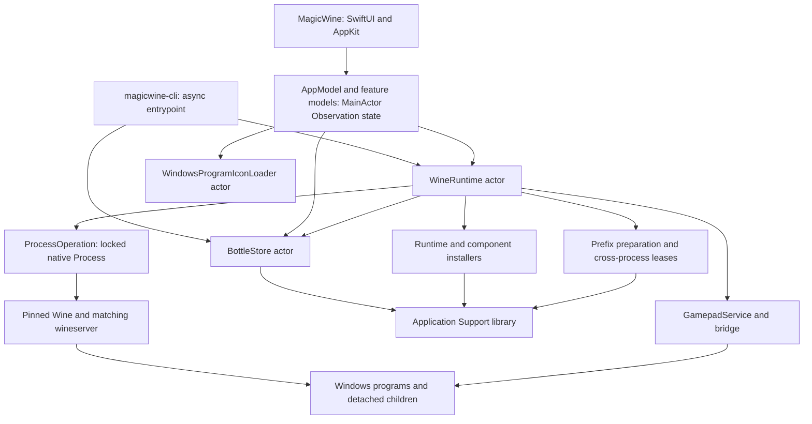

# Architecture and ownership

[Documentation index](README.md) · [Runtime lifecycle](runtime-lifecycle.md)

MagicWine is a native macOS bottle manager and research integration layer around Wine. It is not a Windows virtual machine, a security sandbox, or a guarantee that a particular application will work. A **bottle** combines a Wine prefix, a pinned runtime descriptor, launchers, and bottle-wide settings. Windows software still runs with the host user's privileges.

## Modules and execution boundaries

[`Package.swift`](../Package.swift) declares Swift 6 tooling, macOS 14 as the package deployment minimum, and three products:

| Product / target | Owns | Does not own |
| --- | --- | --- |
| `MagicWine` | SwiftUI/AppKit interface, consent dialogs, selection, presentation state, file-open handling | Wine implementation or authoritative on-disk bottle state |
| `MagicWineCore` | Models, persistence, runtime installation and execution, prefix/component integration, controller service, shortcut and icon parsing | A blanket compatibility promise or system-wide security policy |
| `magicwine-cli` / `MagicWineCLI` | Async command dispatch, arguments, textual results and exit status | The GUI's selection, activity state, or preferred-runtime workflow |



The app's models are `@MainActor` [Observation](https://developer.apple.com/documentation/observation) classes (see [UI model structure](#ui-model-structure)): presentation state and UI updates belong there. Their tasks await core actors rather than synchronously waiting for child processes. Progress callbacks are explicitly delivered to the main queue and checked against an operation UUID so a late callback cannot update a newer installation/setup. [`Main.swift`](../Sources/MagicWineCLI/Main.swift) instead builds its own `ApplicationPaths`, one `BottleStore`, and a `WineRuntime` constructed with that store, and awaits the same core operations. Each process creates exactly one `BottleStore` per library and passes it to `WineRuntime.init(paths:store:)` and to `StorageCleanup.plan(store:includeCurrent:)`/`apply(_:store:)` (which take the library from `BottleStore.paths`), so actor serialization spans every owner of the library's bottle metadata.

`WineRuntime` is an actor, but actor isolation alone is not an operation-wide mutex: methods suspend and other requests can enter. It therefore also tracks active processes, pending launches, settings mutations, and installation guards. `BottleStore` serializes calls within a process, but the app and CLI are separate processes (and tests may open further instances), so bottle metadata transitions also take the filesystem bottle lock (`GraphicsPrefix.withLock`, `Bottles/.graphics-locks/<UUID>.lock`). Both it and [`GraphicsOperationLease`](../Sources/MagicWineCore/GraphicsOperationLease.swift) wait through [`AdvisoryFileLock`](../Sources/MagicWineCore/AdvisoryFileLock.swift): nonblocking `flock` attempts separated by short async sleeps, so a lock held by another process never parks a cooperative-pool thread, a cancelled wait never runs its critical section, and a bounded wait ends in `busy` (the bottle lock gives up after 30 seconds by default). Only the critical section itself is synchronous, and it runs on the caller's actor; while one bottle's lock is awaited, `BottleStore` keeps serving other bottles. Locks are released with an explicit `flock(LOCK_UN)` before `close`.

[`ProcessOperation`](../Sources/MagicWineCore/ProcessOperation.swift) confines Foundation `Process` behind an `NSLock`, starts it on a global queue, and returns through a checked continuation. It does not block an actor waiting for termination. File work is not universally detached: core actors perform some synchronous validation and persistence. Large archive hashing is explicitly moved to a cancellable utility task. Controller discovery has its own main-actor requirements; see [controllers](controllers.md).

## UI model structure

[`AppModel`](../Sources/MagicWine/AppModel.swift) is the composition root: it creates the library's `BottleStore` and `WineRuntime`, hands them to focused models, and runs only the flows that span several of them (startup, Reload Bottles, opening an EXE/MSI from Finder, bottle creation followed by setup). Each model owns one kind of state; none duplicates another's logic, and views observe only the properties they read.

| Model | Owns |
| --- | --- |
| `NoticeModel` | The app-wide alert (`AppNotice`) and `report(_:title:)` |
| [`LibraryModel`](../Sources/MagicWine/LibraryModel.swift) | Loaded bottles, loading state, bottle creation, per-bottle icon revisions; `replace` is the single place a saved bottle from the core enters the UI |
| [`RuntimeModel`](../Sources/MagicWine/RuntimeModel.swift) | Wine runtimes, app settings, preferred/custom Wine, Wine installation and per-bottle Wine update |
| [`BottleActivityModel`](../Sources/MagicWine/BottleActivityModel.swift) | Per-bottle `BottleActivity`, `perform` (exclusive operations and their busy predicates), setup, installers, program list edits, launches by program with their live logs and play sessions, Stop, Trash, per-bottle errors and notices |
| [`BottleSettingsModel`](../Sources/MagicWine/BottleSettingsModel.swift) | Graphics backend/component updates, Retina, MSync, HUD, compatibility switches, per-program launch options and favorites |
| [`StorageCleanupModel`](../Sources/MagicWine/StorageCleanupModel.swift), [`DependenciesModel`](../Sources/MagicWine/DependenciesModel.swift) | Storage plan and removal; dependency status and installation |

Models never present AppKit panels or touch Finder. Views ask for files through the window's single `fileImporter` ([`FileAccess.swift`](../Sources/MagicWine/FileAccess.swift): installer, program, D3DMetal folder, Wine executable), and pass the chosen URL to the model; Finder reveals are view helpers there too. [`GamepadService`](../Sources/MagicWineCore/GamepadService.swift) is observable as well, and only the gamepad subviews that draw live input read its 60 Hz `inputs`. Program icons reload only when their own bottle's record changes and keep the previous image until the new one is decoded.

Window state is not model state. Each library window (`LibraryView` in [`MagicWineApp.swift`](../Sources/MagicWine/MagicWineApp.swift)) keeps its own selected bottle and destination, search text, New Bottle sheet, Trash confirmation, and the files opened from Finder before the library finished loading. App-wide alerts are posted to `NoticeModel` and presented by whichever library window is key (they wait while none is). The window is a `NavigationSplitView`: a `List(selection:)` sidebar ([`LibrarySidebarView`](../Sources/MagicWine/LibrarySidebarView.swift)) with the All Games destination, the bottles, and the Gamepads, Downloads, and Documentation destinations, `.searchable` filtering bottles by their own or their programs' names (the dashboard lists the matching programs, All Games the matching programs of every bottle), and a toolbar with Install EXE/MSI, Add Program, Refresh, and Stop. Wine settings live only in the Settings scene (⌘,). Menu commands ([`LibraryCommands.swift`](../Sources/MagicWine/LibraryCommands.swift)) act on the focused window's selection through `focusedSceneValue`: File › New Bottle… (⌘N) and the Bottle menu's Install EXE/MSI… (⇧⌘I), Add Program… (⇧⌘A), Refresh Programs (⌘R), Launch *program* (⌘↩, the program row last clicked), Stop Windows Processes (⌘.), Show Bottle Logs… (⇧⌘L), Reveal C: Drive (⇧⌘D), and Reload Bottles. The toolbar and the commands use the same `BottleActivity` predicates as the dashboard, and are disabled without a focused library window or selected bottle.

**All Games** ([`GameLibraryView`](../Sources/MagicWine/GameLibraryView.swift)) is derived, not stored: `GameLibrarySections` lists every program of every loaded bottle once, as Favorites (`isFavorite`, most recently launched first), Recently Played (the eight most recently launched other programs), and the rest by name (natural order, then bottle name), filtered by the window's search text against program and bottle names. Each program card shows its icon, name, a **Running** badge from the bottle's `BottleActivity.running`, a button that selects its bottle on the Bottles destination, `ProgramHistory`'s last-launched and play-time line (the same wording as the dashboard), a favorite star (`BottleSettingsModel.setFavorite`, a metadata edit gated by `blocksLibraryEdit`), **Launch** (`BottleActivityModel.launch`, gated by `blocksLaunch` and an initialized bottle, so a running tray launcher can be launched again), and **Running Log** from the newest live launch. Because launches and favorites go through the same models as the dashboard, either view reflects the other immediately.

Files opened or dropped reach the same model calls as the buttons, so the same busy predicates apply. **Open With** (or double-clicking, if MagicWine is made the default) on an EXE, MSI, LNK, or URL file is handled by the window's `onOpenURL`: the file is queued as an `OpenedFile` (kept until the library has loaded) and the window presents `OpenFileSheet`, one file at a time, offering only set-up bottles (the selected bottle preselected), the action that fits the file, and **New Bottle…**. MSI files only install; LNK and URL files only register as programs ([`registerProgram`](../Sources/MagicWineCore/BottleStore.swift)); an EXE is **Run Installer** by default, or **Add as Program** when Option is held as it opens or chosen in the sheet. Nothing runs until the user confirms, and a file waiting for a new bottle runs in it only after its setup succeeds (`AppModel.createBottle(…then:)`; a failed setup posts a notice instead). Dropping files on a sidebar bottle row or on the dashboard installs one EXE/MSI like Install EXE/MSI (setup done, `blocksPrefixMutation` clear), and dropping EXE/LNK/URL files on the Installed Programs card adds them in one library edit like Add Program (`blocksLibraryEdit`, so allowed while programs run). A target highlights only while a drop could start something; refused drops post the usual notice. [`Info.plist`](../Resources/Info.plist) declares the document types at Alternate rank (MagicWine is offered in Open With but never takes over a default): macOS's own `com.microsoft.windows-executable` (.exe) and `com.microsoft.internet-shortcut` (.url) are imported, and `org.magicwine.windows-installer` (.msi) and `org.magicwine.windows-shortcut` (.lnk), which have no system type, are exported.

Appearance follows the system: no scene forces a color scheme. [`WinePalette`](../Sources/MagicWine/WineColors.swift) defines every color as a dynamic `NSColor` with a light and a dark variant (surfaces `background`/`sidebar`/`panel`/`elevated`, `text`/`muted`, the wine-red `accent`/`accentDeep`/`onAccent`, `success`/`warning`/`danger`/`favorite`, and the gamepad diagram's button colors), and [`WineTheme`](../Sources/MagicWine/WineTheme.swift) exposes them as SwiftUI `Color`s. Views use these tokens rather than literal colors (the program editor still uses the system's `.red` and `.secondary`, which adapt on their own). Text and status tokens reach WCAG 4.5:1 and `accent`/`favorite` 3:1 against every surface in both appearances; keep that when changing a value, and verify it by resolving each color under `NSAppearance(named: .aqua)` and `.darkAqua`. The cellar artwork behind the dashboard and gamepad headers is a faint watermark in light appearance. Type uses `WineTheme.Font`: text styles (`body`, `callout`, `small`, `caption`, `heading`, `subheading`, `mono`) follow the system's text-style sizes; the serif `display`/`title` and the symbol sizes are fixed point sizes because macOS has no Dynamic Type scaling. The gamepad diagram's canvas labels, sized in drawing units, are the only other literal size.

Localization starts from English. `Package.swift` sets `defaultLocalization: "en"` and the app target processes [`Localization/en.lproj`](../Sources/MagicWine/Localization/en.lproj) (`Localizable.strings` and `Localizable.stringsdict`) into `MagicWine_MagicWine.bundle`; a String Catalog (`.xcstrings`) is not used because SwiftPM compiles it with `xcstringstool`, which the Command Line Tools the project builds with do not include (`swift build` fails with "Could not read xcstrings file"). Text built in code (activity titles, notices, status words, counts) goes through `localized(_:)` in [`Localization.swift`](../Sources/MagicWine/Localization.swift), a thin `String(localized:bundle:locale:)` over `Bundle.wine` whose key is the English text (`%@` for strings, `%lld` for integers) and whose plural rules follow the language actually shown rather than the system region; counted phrases are `.stringsdict` entries with proper plural categories, so there are no hand-made `"\(n) item\(n == 1 ? "" : "s")"` suffixes. SwiftUI `Text("…")` literals use the same rule against `Bundle.main`, and `build-app.sh` copies each `*.lproj` of the UI bundle into the app's `Contents/Resources` for that; a literal without an entry shows its English text. To add a language, copy the `en.lproj` folder to `<language>.lproj`, translate the values and plural forms, and add the language to `CFBundleLocalizations` in `Info.plist`. Core errors (`MagicWineError` messages and recovery suggestions, shared with the CLI) and CLI output stay English for now; the app shows them as received.

## Persistent library

[`ApplicationPaths`](../Sources/MagicWineCore/Models.swift) defaults to `~/Library/Application Support/MagicWine`. CLI `--root <directory>` must precede the command and selects a different library; it is not a runtime-selection flag.

```text
MagicWine/
├── settings.json
├── runtime-inspections.json          # cached wine --version results for discovery
├── Bottles/
│   ├── .graphics-locks/<bottle-UUID>{,-launch,-lifetime}.lock, storage-cleanup.lock
│   └── <bottle-UUID>/
│       ├── bottle.json
│       ├── prefix/
│       │   ├── drive_c/
│       │   ├── dosdevices/
│       │   ├── system.reg
│       │   └── user.reg
│       └── graphics/                 # backend state and caches, when used
├── Runtimes/
│   ├── wine-11.0_1-b50dc50ec7f4-winemac-wine11.0-metal.7/
│   │   ├── installation.json
│   │   └── Wine Stable.app/Contents/Resources/wine/
│   └── .graphics-views/<receipt-digest>/  # private Metal runtime views
├── Components/                       # managed/imported graphics components
│   └── dependencies/<id>-<sha256-prefix>/  # verified Windows dependency downloads
└── Logs/
    ├── Bottles/<UUID>/               # one bottle's process logs; dxvk/, dxmt/ backend logs
    └── Library/                      # Wine/component installs, failed version inspections
```

This is the principal layout, not an exhaustive list of controller, compatibility, or transaction files. Graphics state is described in [graphics](graphics.md); controller persistence in [controllers](controllers.md). Installers stage into temporary `.install-<UUID>` (and `.d3dmetal-<UUID>`) directories under `Runtimes`, `Components` or `.graphics-views` and remove them on exit. Logs are the one category MagicWine prunes by itself ([`ProcessLogs`](../Sources/MagicWineCore/ProcessLogs.swift): newest 50 per folder within 256 MiB, never a log still being written); older flat `Logs/*.log` files from earlier versions stay in place under the same policy. See [debugging](debugging.md#4-inspect-the-right-evidence).

Nothing in normal operation deletes a runtime, component, private view, or lock file: an old managed Wine stays for bottles pinned to it, a replaced component stays until no bottle needs it, and any change to the runtime or component files a view records (including metadata such as a re-consented quarantine removal) produces a new view next to the old one. [`StorageCleanup`](../Sources/MagicWineCore/StorageCleanup.swift) (CLI `cleanup`, **Downloads › Storage**) computes what nothing references from the bottles' pinned runtimes and component IDs, `settings.json`, and the exact view identities launch would use, and removes only entries confirmed from that plan while every bottle is idle. It never touches `Bottles/<UUID>/`; see [runtime lifecycle](runtime-lifecycle.md#reclaiming-storage) for the rules.

Names are display metadata, never directory paths. `BottleStore` trims names and permits 1–80 characters; UUIDs identify bottles and launchers. A bottle stores creation time, its `RuntimeDescriptor` (executable URL and reported version), initialization status, program list, graphics configuration, MSync preference, display preference, compatibility switches (Rosetta AVX advertising, Wine debug output, DXVK HUD preset), and installed dependencies. New defaults are Standard graphics, MSync enabled, Retina enabled at 192 DPI, AVX advertising off, quiet Wine debug output, and the detailed DXVK HUD.

`bottle.json` carries `schemaVersion` (currently `1`, `Bottle.currentSchemaVersion`); every save writes the current version. Records without it are legacy version `0` and migrate on decoding: a missing graphics field means Standard, missing MSync means on, missing compatibility means the default switches, missing dependencies means none, and a missing display is adopted from the prefix's registry by `BottleStore` (the absence is retained internally so normalization stays deliberate). A program's launch options, own graphics choice (`graphics`), play history (`lastLaunchedAt`, `playTime`) and favorite flag are omitted while empty in every version, so a missing one means none, Bottle default, zero, or not a favorite in legacy and current records alike. Reading never rewrites a record; the next metadata write (including a play-history or favorite update) stores it in the current version. A record with a newer `schemaVersion` than this build reads is refused with `MagicWineError.newerVersion` and left unchanged, so an older MagicWine never drops fields a newer one wrote; a negative or non-integer version is invalid metadata. Each load decodes `bottle.json` once, under the bottle lock, before graphics recovery (which never rewrites it).

`settings.json` holds custom Wine and preferred Wine paths. It does **not** override the runtime already recorded in a bottle. Metadata writes use atomic replacement. Loading checks UUID agreement and directory/metadata ownership, and rejects unsafe links; one malformed bottle can fail listing rather than being silently omitted. General `save` refuses runtime, graphics, display, synchronization, initialization, or compatibility-switch changes, and changes to an existing program's name or launch options: those belong to the validated `WineRuntime` transitions (including `WineRuntime.initialize`, the only way a bottle becomes initialized), `BottleStore.setCompatibility`, and `BottleStore.updateProgram`, not arbitrary model editing. A program's play history and favorite flag are written only by `BottleStore.recordLaunch`, `addPlayTime`, and `setFavorite`; `save` and `updateProgram` keep the saved values, so an editor opened before a game ended neither fails nor erases its play time. See [`BottleStore.swift`](../Sources/MagicWineCore/BottleStore.swift).

## Launchers, shortcuts, and icons

A `WindowsProgram` stores a UUID, a display name, a filesystem path, and optional launch options (arguments, working directory, environment variables, DLL overrides; see [runtime lifecycle](runtime-lifecycle.md#per-program-launch-options)). It also keeps library metadata: `lastLaunchedAt`, accumulated `playTime` in seconds, and `isFavorite` (omitted while unset; older records decode as never launched, no play time, not a favorite; a negative play time fails decoding). The app records a launch when the program's process starts and, when the last of its overlapping launches ends, adds the time since the first of them started (system uptime, so sleep is not counted); launches by the CLI are not recorded. Favorites are listed first, then by name or most recent launch. Registering an EXE/LNK/URL file does not copy or install it. Removing a launcher only removes metadata. Paths may refer outside the bottle, which matters when moving or deleting a library.

Discovery scans shared Start Menu programs and relevant user Desktop/Start Menu folders for `.lnk` and `.url` files, skips symbolic links and uninstall-named candidates, sorts candidates deterministically, and deduplicates launch identities. It does not enumerate every EXE in `Program Files`. [`WindowsShortcut`](../Sources/MagicWineCore/WindowsShortcut.swift) supplies identity and local icon-source resolution; Wine remains responsible for actually executing shortcuts (`start /unix`).

[`BottleDesktop`](../Sources/MagicWineCore/BottleDesktop.swift) prepares real per-profile Desktop directories before launching Wine or scanning shortcuts. If Desktop is a symbolic link, it removes the link itself, never copies, enumerates or deletes its host target. This prevents installer shortcuts being placed on the macOS Desktop; it does not turn the prefix into a sandbox.

[`WindowsProgramIconLoader`](../Sources/MagicWineCore/WindowsProgramIconLoader.swift) reads local ICO/PE icon data without launching Wine or changing the bottle. Its actor owns a 256-entry `NSCache`, keyed by source and icon index and invalidated by size/mtime changes, including negative results. It decodes thumbnails up to 76 pixels rather than arbitrary full-sized bitmaps. Missing/unreadable icons are presentation failures, not launcher failures.

## Busy is not the same as running

`BottleActivity.title` describes an exclusive UI operation, such as installation, initialization, configuration, or discovery. `running` tracks independent launch tasks by program ID (the dashboard marks each running program, the sidebar and dashboard name them, and **Show Running Log** follows that program's newest launch). A long-lived launcher in the Windows tray must not prevent clicking another program or reopening the launcher, so the UI permits additional launches of it or other programs while it runs. `isStopping` is separate again.

The UI names three gates as predicates on `BottleActivity`: `blocksLaunch` (exclusive operation or Stop in progress), `blocksLibraryEdit` (the same; Refresh, Add Program, Edit Program, Remove from MagicWine, Reload Bottles), and `blocksPrefixMutation` (those plus running programs; graphics, MSync, Retina, installers, Wine update, winecfg, Trash). Library edits only rewrite `bottle.json` and read shortcut files under the bottle lock, so a tray-resident Steam does not stop new games from being discovered. Discovery's `BottleDesktop.prepare` is a no-op once a launch has prepared the prefix's Desktop directories.

These are **UI observations**, not an authoritative process inventory. An EXE may spawn a child and exit; a separate CLI process may launch Wine; a shortcut may return before its target exits. Core operations therefore consult leases and the prefix's real `wineserver`, not just UI activity. Shortcut launch waits on `wineserver -w`; ordinary EXE launch observes its direct Wine process. The exact handoff, stop, timeout and mutation rules are in [runtime lifecycle](runtime-lifecycle.md).

## Errors and recovery

Core operations throw [`MagicWineError`](../Sources/MagicWineCore/MagicWineError.swift), whose case names the kind of failure: invalid name/program/bottle/input, not initialized, busy (`BusyReason`: running programs or another operation), conflict (the bottle changed elsewhere), consent required (`Consent`), timed out, process failed (nonzero exit or signal), stopped (a deliberate Stop, which the app records as a log event rather than a failure), operation failed (an install or setup step with its log), runtime unavailable or incompatible (with a `RuntimeRemedy`), invalid graphics component, unsupported host, integrity failure (a file, archive, receipt or backup that does not match its pin or layout), unsafe filesystem refusal (links, unexpected file types, files MagicWine did not install), newer version (saved data in a format newer than this build reads, left unchanged; no recovery action, its suggestion is to use the newer MagicWine, and the dashboard card is titled "Saved by a Newer MagicWine"), and download failure. `setup` remains only for unexpected system errors (`strerror` results, failed directory enumeration) and internal invariants. Every error exposes:

- `errorDescription`: a readable message without log paths and without instructions for a particular surface (no CLI flags or app button names);
- `logURL`: the log that explains it, when one was written (failed, timed-out or stopped processes and probes, failed installs, a still-running server);
- `recoveryActions`: what may fix it (`showLog`, `stopBottle`, `retrySetup`, `restoreStandardGraphics`, `updateGraphicsComponent`, `updateWine`, `chooseWine`, `installRosetta`, `giveConsent`, `reload`, `retry`), with `recoverySuggestion` as surface-neutral text. The core decides what it knows, for example MSync on an older managed runtime offers `updateWine` while a custom runtime offers `chooseWine`.

Surfaces offer only the actions that apply to the bottle as it is now (`RecoveryAction.isAvailable(for:)`: restoring Standard needs a non-Standard backend, a component update needs `GraphicsConfiguration.hasComponentUpdate`, setup a bottle that is not initialized). The app stores a `PresentedError` (message, suggestion, log, actions) in `BottleActivity.error`; the dashboard's `OperationErrorCard` ([`ErrorPresentation.swift`](../Sources/MagicWine/ErrorPresentation.swift)) shows **Show Log** (or **Show Logs** without one) and buttons for the actions the app performs (Stop, Retry Setup, Restore Standard Graphics, Update Component… and Update Wine… behind their usual confirmations, New Bottle with Other Wine…, Reload), and alerts (`AppNotice`) carry the message, suggestion and log. [`CommandLineErrorReport`](../Sources/MagicWineCore/CommandLineErrorReport.swift) renders the CLI form: `error:`, `log:` and one `hint:` command per applicable action, with exit status 1. Operations that wrap other failures (Wine and DXVK installation, dependency installs) report their own operation log and keep the underlying error's recovery actions (`MagicWineError.failed(_:logURL:underlying:)`, `withLog(_:)`).

## Packaged resources and trust

The core target copies exact binary/source/license/provenance resources rather than treating them as UI assets: controller DLLs, DXVK and DXMT archives, compressed patched Wine modules and matching server, and the WoW64 CPU repair DLL. The GUI processes its own `Assets` separately. Code accesses core resources through `Bundle.module`; the executable alone is not a complete deployable artifact. See [development](development.md) for packaging/build recipes.

[`WineMetalDriver`](../Sources/MagicWineCore/WineMetalDriver.swift) verifies compiled-in digests for compressed images, decompressed images, source, license and provenance. It replaces modules only inside a fresh managed staging tree, retaining validated originals, the license, provenance, and a `CORRESPONDING-SOURCE.txt` reference (source archive name, SHA-256, and resource-bundle location) under `runtime-compatibility/<component-ID>` in the Wine runtime. Runtimes staged by earlier versions hold a full source copy there instead and still validate. It does not patch an arbitrary user-selected Wine installation. Resource/source/license boundaries are substantive: locally obtained Apple D3DMetal libraries are not bundled or downloaded, and experimental-backend consent does not accept their license. See [graphics](graphics.md).

Shared validation primitives live in [`SecureFS`](../Sources/MagicWineCore/SecureFS.swift) (no-follow `lstat`/`O_NOFOLLOW` checks, bounded streaming SHA-256 that rejects files changed while read, inode/mtime/ctime stamps with the process-local adoption cache, exclusive `renamex_np(RENAME_EXCL)` publication, quarantine preservation), [`MachOInspector`](../Sources/MagicWineCore/MachOInspector.swift) and [`PEInspector`](../Sources/MagicWineCore/PEInspector.swift) (header-only binary inspection; never loads code). [`BundledArchive`](../Sources/MagicWineCore/BundledArchive.swift) is the shared copy/hash/member-check/extract stage of the DXVK and DXMT installers. Each component passes its own size limits, hard-link tolerance, builtin-marker requirement and error prefix, so these helpers centralize mechanics, not policy; new installers and compatibility code should reuse them rather than add private copies.

A SHA-256 match proves agreement with a pin, not that software is safe. Managed Wine installation requires explicit permission to run unsigned third-party code and remove quarantine inside the managed Wine app only; it does not disable Gatekeeper. Inspecting a custom runtime executes its `--version`, so selecting an executable is itself a trust decision. Windows software and custom wrappers can access user files and escape intended prefix conventions; environment cleanup is configuration isolation, not hostile-code containment.

## Adding a graphics backend

Backend-specific wiring lives in one place: a `GraphicsComponentProvider` in [`GraphicsComponentProvider.swift`](../Sources/MagicWineCore/GraphicsComponentProvider.swift). `WineRuntime` (setup, component updates, runtime check, launch facts), `GraphicsPrefix` (DLL footprint), `GraphicsRuntimeView` (private-view overlay), `GraphicsConfiguration.usesSupportedComponent`/`hasComponentUpdate`, and `StorageCleanup` (component kind, current/imported status, views to keep) look the provider up from `GraphicsBackend` instead of switching over it. To add a backend:

1. Add the `GraphicsBackend` case and display name in [`GraphicsModels.swift`](../Sources/MagicWineCore/GraphicsModels.swift).
2. Write its installer (pins, receipt, `install`, `validate`, `validateRuntime`), reusing `SecureFS`, `BundledArchive`, `MachOInspector` and `PEInspector`.
3. Add a provider: component directory prefix, current component ID (or `nil` and `isImported` for user imports), retained older component IDs the installer still validates against their own receipts (bottles using them keep launching and can be updated in place), prefix DLL mappings (persisted in bottle manifests and journals, so stable once published), view substitutions (empty when the bottle's own loader works), `launchesWithoutPrefixFiles` (true only when the private view alone selects the backend because every Windows module it replaces exists in any prefix; it lets a single program use the backend in another bottle, see [per-program graphics](graphics.md#per-program-graphics)), cache folder, and `launchFacts` returning the planner's `GraphicsLaunchFacts`. Register it in `GraphicsComponentProviders.bundled`.
4. Extend `GraphicsLaunchFacts`/`LaunchPlanner.graphicsLayer` only if neither the DXVK nor the Metal fact shape fits, and add the backend's notice and details to the dashboard ([`GraphicsSettingsView.swift`](../Sources/MagicWine/GraphicsSettingsView.swift)) and its CLI name to the `graphics` usage.
5. Document it in [graphics](graphics.md) and add installer, prefix-transaction, and planner tests.

Continue with [runtime lifecycle](runtime-lifecycle.md), [compatibility](compatibility.md), and [debugging](debugging.md) for the operational consequences of these boundaries.
