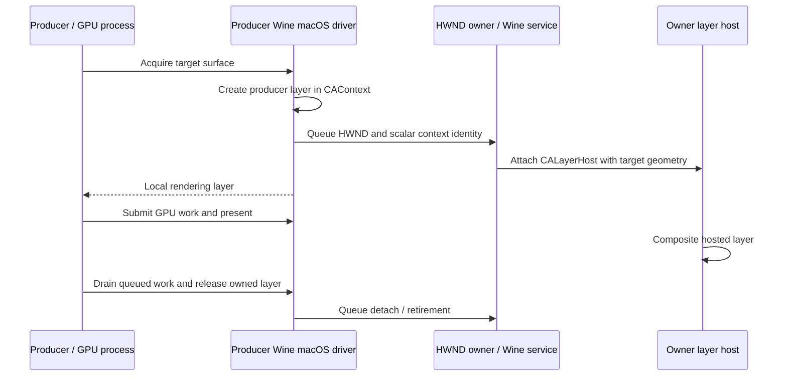

# Compatibility patches and launch policy

[Documentation index](README.md) · [Graphics](graphics.md) · [Development](development.md)

Compatibility work lives at two levels: rebuilt Wine/renderer components and Swift-side launch preparation. Rebuilding the app does not migrate a bottle to a new Wine runtime; changing an environment variable does not add missing native ABI support. This guide identifies which layer owns each change.

## Component boundaries

| Component | Current identity | Integration owner |
| --- | --- | --- |
| Matched Wine native/Windows modules and server | `winemac-wine11.0-metal.7` | [WineMetalDriver.swift](../Sources/MagicWineCore/WineMetalDriver.swift), [RuntimeInstallation.swift](../Sources/MagicWineCore/RuntimeInstallation.swift) |
| Prefix-local WoW64 CPU correction | `wow64cpu-wine11.0-magicwine.1` | [RosettaCPUCompatibility.swift](../Sources/MagicWineCore/RosettaCPUCompatibility.swift) |
| Altered DXMT renderer | `dxmt-v0.80-remote.1` | [DXMTInstallation.swift](../Sources/MagicWineCore/DXMTInstallation.swift), [DXMTRemoteBuildPins.swift](../Sources/MagicWineCore/DXMTRemoteBuildPins.swift) |
| Altered macOS DXVK fork | `dxvk-macos-1.10.3-magicwine.2` | [DXVKInstallation.swift](../Sources/MagicWineCore/DXVKInstallation.swift) |

The managed base download remains Gcenx Wine `11.0_1`, which reports `wine-11.0`. A version string alone cannot distinguish these compatibility revisions. Historical DXMT `dxmt-v0.80` has its own validation path and must not be relabeled as the altered renderer.

## Patch inventory

The five managed-Wine patches below apply in the listed order with zero fuzz in [build-metal-wine.sh](../scripts/build-metal-wine.sh). They form one matched build, not five independently swappable binary fixes.

| Managed Wine patch | Mechanism and affected area | Focused evidence |
| --- | --- | --- |
| [wine-metal-driver.patch](../patches/wine-metal-driver.patch) | Wine macOS Metal client-surface bridge; native/PE driver callbacks, `ntdll` ABI/TLS support, historical D3DMetal interface | Metal backend startup/presentation; matching native/PE modules are required |
| [wine-mouse-pointer.patch](../patches/wine-mouse-pointer.patch) | Mouse-in-pointer messages and query state through `win32u`, `user32`, and WoW64 conversions | [test-mouse-pointer.sh](../scripts/test-mouse-pointer.sh) |
| [wine-wpad-macos.patch](../patches/wine-wpad-macos.patch) | Host proxy-autodiscovery policy through SystemConfiguration, Unix `winhttp.so`, and both Windows WinHTTP modules | [test-wine-proxy.sh](../scripts/test-wine-proxy.sh), Windows and native modes |
| [wine-remote-metal.patch](../patches/wine-remote-metal.patch) | Cross-process owner/producer Metal presentation and lifetime, including child windows and HUD-safe layers | [test-remote-presentation.sh](../scripts/test-remote-presentation.sh) with matched renderer |
| [wine-msync.patch](../patches/wine-msync.patch) | Mach/shared-memory/ulock synchronization via Wine's in-process synchronization hooks; paired `ntdll` and `wineserver` protocol | [test-msync.sh](../scripts/test-msync.sh), both modes and Windows architectures |

Other builds are separate:

| Patch | Purpose | Build recipe |
| --- | --- | --- |
| [wine-wow64cpu-rosetta.patch](../patches/wine-wow64cpu-rosetta.patch) | Public CodeWeavers Rosetta far-call/far-return correction for Wine's WoW64 transition module | [build-wow64cpu.sh](../scripts/build-wow64cpu.sh) |
| [dxmt-remote-metal.patch](../patches/dxmt-remote-metal.patch) | Capability-gated foreign-window presentation, owned layer lifetime, and safe release after queued GPU work | [build-dxmt.sh](../scripts/build-dxmt.sh) |
| [dxvk-pipeline-statistics.patch](../patches/dxvk-pipeline-statistics.patch) | Avoid unsupported Vulkan query allocation; preserve query lifecycle and report unavailable results without writing fake counters | [build-dxvk.sh](../scripts/build-dxvk.sh) |
| [dxvk-d3d10-device.patch](../patches/dxvk-d3d10-device.patch) | Remove unrelated WineD3D pre-rejection; let DXVK validate adapter/feature-level support | [build-dxvk.sh](../scripts/build-dxvk.sh) |
| [dxvk-d3d9-macos.patch](../patches/dxvk-d3d9-macos.patch) | Modern MinGW build compatibility and conditional geometry/cull-distance Vulkan feature requests | [build-dxvk.sh](../scripts/build-dxvk.sh) |

CPU build support files are not replacement DLLs:

- [wine-wow64cpu.def](../patches/wine-wow64cpu.def) defines the Wine CPU module's exports.
- [wine-wow64cpu-ntdll.def](../patches/wine-wow64cpu-ntdll.def) and [wine-wow64cpu-wow64.def](../patches/wine-wow64cpu-wow64.def) generate the required import libraries.
- The separate [XInput export definition](../Sources/GamepadBridge/xinput.def) belongs to the original controller bridge, documented in [Controllers](controllers.md).

## Public provenance and licenses

Wine changes remain LGPL-2.1-or-later. The Metal bridge follows public Whisky Wine interface code, public CodeWeavers native/TLS code, and attributed WineForge TLS work. Mouse-pointer work backports the Wine changes attributed inside the patch. Remote Metal transport adapts Wine commit `1a63b0d7c431f1ebbaba9afd2daa312690eb8020` by Marc-Aurel Zent/CodeWeavers. MSync retains Marc-Aurel Zent and Zebediah Figura attribution and public CrossOver integration sources.

The authoritative attribution, pinned upstream inputs, and license text are retained in [LICENSE-WINE-METAL.txt](../Sources/MagicWineCore/Resources/LICENSE-WINE-METAL.txt), [LICENSE-WINE-WOW64CPU.txt](../Sources/MagicWineCore/Resources/LICENSE-WINE-WOW64CPU.txt), patch headers, and corresponding-source archives. Public references include [Wine](https://github.com/wine-mirror/wine), [wine-msync](https://github.com/marzent/wine-msync), and the pinned [CrossOver source mirror](https://github.com/rnowak/wine-crossover-sources/tree/b4f3c510a1808e6e32fb99e9bc11fa46ccc207dc/wine). This does not mean proprietary CrossOver binaries are bundled.

The selected DXMT v0.80 code and its remote patch are MIT; dependencies keep their own terms. The DXVK macOS fork uses zlib/libpng terms plus dependency notices. Root MIT licensing does not override those boundaries. Some immutable upstream notices describe the original release; use current provenance and patch records to identify the altered payload. See [THIRD_PARTY_NOTICES.md](../THIRD_PARTY_NOTICES.md).

## Native Metal bridge and Windows thread state

The Metal bridge must connect native macOS views/layers to Windows handles and call conventions without replacing the host's thread-local assumptions. Managed Metal Wine keeps Darwin pthread GS active for native code. Its `ntdll` changes expose the required ABI entrypoints, mirror selected Windows TEB fields, centralize TLS-vector updates, and clean up shadow state on thread exit. They are not permission to assume arbitrary Windows inline GS accesses are safe.

The build includes native `winemac.so`, `ntdll.so`, `win32u.so`, `winhttp.so`, `wineserver`, both Windows architectures of the required driver/`ntdll`/`user32`/`winhttp` modules, and 64-bit `wow64win.dll`. Resources are compressed as raw DEFLATE to keep Swift's resource processing from altering pinned Mach-O bytes. The installer preserves verified stock originals and complete source/license/provenance material.

Do not copy a new driver beside an old native `ntdll`, or replace only one PE architecture. Host ABI inspection, compressed-image pins, replacement-image pins, and original-image pins all participate in installation.

## Cross-process Metal presentation

A launcher can create its graphics device in a GPU process while another process owns the target HWND. Treating every target as a local view is insufficient.

Only handles and scalar context identifiers cross the Wine messages, not Objective-C pointers. Producer rendering and owner window ownership remain separate. The transport accounts for child geometry, sibling clipping, Retina changes, reparenting, and target/process death.

A real detached `NSView` remains for the historical geometry ABI, but the exported rendering layer belongs to a `CAContext`, not to that view as an AppKit backing layer. This avoids a Metal HUD path assuming an associated view has a real window. Attach/release work is queued instead of synchronously waiting for an HWND owner that may not pump messages during GPU startup.

DXMT checks both the target owner and root owner. Required remote paths depend on `magicwine_metal_remote_v1` and `magicwine_metal_remote_copy_layer`. The latter returns an **owned** layer; the renderer releases it after queued GPU work is finished. Missing remote capability or failed atomic acquisition produces a controlled failure, not a borrowed-layer fallback. The older interface's layer access remains borrowed; ownership cannot be interchanged casually.

The matched DXMT rebuild changes both `d3d11.dll` and `winemetal.dll` Windows architectures plus native `winemetal.so`. Stock DXGI and verified generated shader arrays remain unchanged. These five rebuilt files must agree with the Wine-side bridge.

A successful `Present` call and GPU readback demonstrate producer-side behavior, not correct final macOS composition. The remote-presentation runner has a separate visual mode; see [Development](development.md).

## MSync: one client/server protocol

MSync reduces certain synchronization round trips using shared state, Mach messaging, and Darwin shared ulocks. It participates in Wine's object semantics rather than replacing waits with polling or ignoring them: events, semaphores, recursive/abandoned mutexes, wait sets, APCs, and process/thread lifetime remain meaningful.

The patch includes wait-all rollback, checked counts, demand-zero mapping publication, and authenticated reference reclamation. The client and server share generated protocol version 932. The build regenerates request definitions and validates that version. **Replacing only `ntdll` or only `wineserver` is invalid.**

`WINEMSYNC=0` selects ordinary server synchronization. Client/server mode disagreement fails in both directions rather than silently switching the live server's mode. At the application layer:

- Only the exact current managed runtime location is treated as MSync-capable; a matching `wine-11.0` label is insufficient.
- The bottle preference defaults on. Current managed launches set `WINEMSYNC=1` or `0` and disable competing ESync/FSync switches.
- Older/custom runtime synchronization settings are not taken over by that managed policy.
- A preference change or runtime adoption requires an idle bottle, including absence of a detached live server. It does not kill a game just to change synchronization.

[test-msync.sh](../scripts/test-msync.sh) checks both Windows architectures with MSync off/on, real activation output, mismatched-client rejection, and recovery of the original server mode. Its optional bounded handoff benchmark measures synchronization overhead, not game FPS or a promised speedup.

## Rosetta WoW64 CPU correction

The separate CPU patch adapts public CW HACK 20760. It detects the `VirtualApple` processor brand and changes problematic long-jump transitions to the far-call/far-return sequence needed under Rosetta. This is not general CPUID spoofing or a CPU-feature unlock. The output is a 64-bit `wow64cpu.dll` implementing transitions for 32-bit Windows execution.

Production preparation in [RosettaCPUCompatibility.swift](../Sources/MagicWineCore/RosettaCPUCompatibility.swift) runs on ARM64 hosts only. Eligibility requires exactly `wine-11.0`, safe runtime directories, and the known stock runtime CPU hash. Unknown runtimes are left untouched; a custom prefix CPU DLL is refused rather than overwritten.

For an eligible owned prefix, the installer verifies the bundled DLL, source, and license; retains the original and matching materials under `runtime-compatibility/wow64cpu-wine11.0-magicwine.1/`; and atomically replaces only the prefix's `system32/wow64cpu.dll`. An already managed DLL without its verified original backup is an error. Shared runtime files stay unchanged.

[WineRuntime.swift](../Sources/MagicWineCore/WineRuntime.swift) invokes this during initialized non-server launch preparation under the prefix lock, then adds `wow64cpu=n` only when applicable. It does not persist a registry-wide override. The repair is optional for a launch: if it refuses (custom prefix DLL, damaged backup, missing bundled resources), the program still starts with no `wow64cpu` override, so Wine's builtin module loads, and the user receives a warning when the process starts. Some 32-bit programs can then crash under Rosetta.

## App-level launch corrections

These policies take effect through the rebuilt app/CLI and do not themselves rebuild Wine:

| Policy | Scope and reason | Boundary |
| --- | --- | --- |
| `MONO_DEBUG=use-fallback-tls` | Current and older managed Metal runtime families; use Mono API-based thread-local storage rather than inline GS-relative dynamic TLS | Preserves other options, avoids duplicates, does not target arbitrary custom Wine; TLS here is **thread-local storage**, not HTTPS |
| `shdocvw=n,b` | Prefer application-local browser interop assemblies before Wine's namesake DLL | Not a complete repair of old embedded browser launchers |
| Bottle-local Desktop | Replace host Desktop symlinks with real bottle directories before Wine work/discovery | Removes only the link, not host files; other Wine host mappings remain |
| Retina/display preparation | Coordinate registry DPI and Wine Mac Driver RetinaMode with saved display metadata | Automatic adoption never kills a live game; explicit core/CLI changes can stop Wine |
| `ROSETTA_ADVERTISE_AVX=1` (opt-in) | Bottle switch **Advertise AVX to Rosetta**, per-program override; Apple's Game Porting Toolkit documents it for Rosetta 2 on macOS 15+ so x86_64 games requiring AVX/AVX2 can start | Set only for x86_64-only Wine under Rosetta on macOS 15+ (otherwise a launch warning); it changes what Rosetta advertises, not Wine, and is not CPUID spoofing by MagicWine |
| `WINEDEBUG=fixme-all` (default) | Bottle switch **Wine debug output** Quiet; smaller logs without unimplemented-function notes | `err:` lines stay for `ProcessLogSummary`; Wine default and one-off diagnostic launches are available ([debugging](debugging.md#diagnostic-launch)) |

Sources: [WineRuntime.swift](../Sources/MagicWineCore/WineRuntime.swift), [LaunchPlanner.swift](../Sources/MagicWineCore/LaunchPlanner.swift), [CompatibilityOptions.swift](../Sources/MagicWineCore/CompatibilityOptions.swift), [BottleDesktop.swift](../Sources/MagicWineCore/BottleDesktop.swift), [BottleDisplay.swift](../Sources/MagicWineCore/BottleDisplay.swift).

## Mouse-pointer and proxy limits

**Mouse-in-pointer:** the first process-wide `EnableMouseInPointer` choice is permanent. Accepted removed mouse events produce pointer state/messages; peeking with `PM_NOREMOVE` does not duplicate delivery. Five buttons, held-button movement, wheel signs, and WoW64 field conversion are handled while classic mouse delivery remains. This is mouse ID/current-frame support, not complete pen/touch devices, pointer history, or every pointer-only filtering/capture path.

**WPAD:** every discovery call consults macOS proxy-autodiscovery policy before reusing cached WPAD results. Missing/disabled host policy returns the ordinary autodetection-failed result promptly. Enabled, unavailable, or malformed policy preserves Wine's normal discovery path. Explicit PAC evaluation and argument validation remain intact. This is not a global proxy bypass, DNS override, or TLS-certificate change. Networks requiring autodiscovery still need the appropriate host configuration.

## Rebuilding and changing a component

[Development](development.md) gives the exact recipes and prerequisite distinctions. Treat artifact updates as a coordinated change:

1. Identify the owning layer and reproduce the relevant failure in an isolated prefix/library.
2. Update the source patch against its pinned upstream input; preserve attribution and license terms.
3. Rebuild the matched module set with the recipe's actual required tools and inputs.
4. Retain corresponding source, build recipe, provenance, notices, and original upstream material where required.
5. Independently verify output hashes/architectures and update the owning compiled pins and package resource list as needed.
6. Consider installed receipts/backups and component identity before publishing different bytes. A pin edit alone is not a migration.
7. Exercise the changed Windows API/backend path and its failure cases, then document the evidence and limits.

The DXMT recipe deliberately uses pinned older `metal.4` **development inputs**, even though the current managed runtime is `metal.7`; do not substitute the newest runtime tree automatically. The source archive preserves the matching build inputs. Conversely, a historical component identity must not be reused to claim a new implementation.

No dedicated general DXVK rendering smoke runner is checked into `scripts/`; Swift installation tests are not a substitute for a real game or a purpose-built graphics probe. Existing historical changelog observations are context, not proof of a fresh rebuild.
