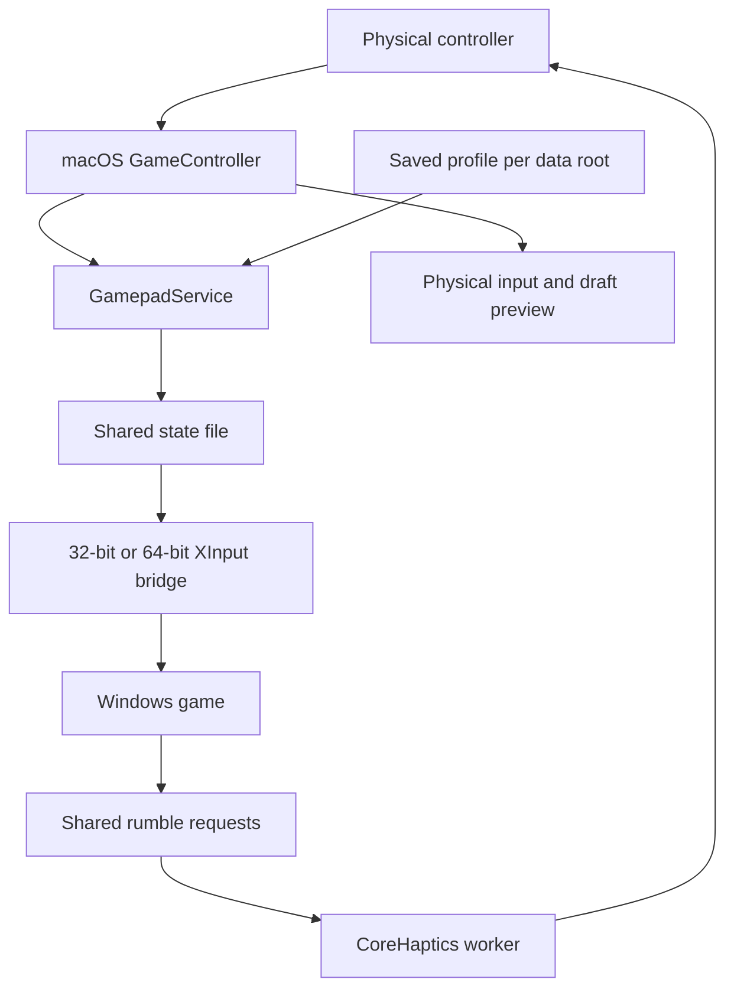

# Controllers and XInput

[Documentation index](README.md) · [Architecture](architecture.md) · [Debugging](debugging.md)

MagicWine reads controllers through Apple's GameController framework, applies a saved profile on the macOS side, and publishes the result to Windows XInput DLLs through a shared file. This is separate from Wine's mouse-pointer support and from the graphics backend.

## Input and feedback path



The native service is an in-process, main-actor singleton, not a background daemon. It keeps its observers and input timer alive for the hosting process, including while the UI is not frontmost. Each application data root used by that process gets its own bridge session. Separate app/CLI processes do not share a single global state file.

Source: [GamepadService.swift](../Sources/MagicWineCore/GamepadService.swift).

## Discovery and slots

Only non-snapshot controllers with an `extendedGamepad` layout participate. macOS must recognize the controller first; pairing and connection are handled by the OS, not a Windows driver installer.

There are four XInput slots. Existing connected controllers retain their slot when another disconnects; unassigned controllers fill available slots. Extra devices may appear in the native UI without receiving an XInput player index. Slot assignment is not a persistent hardware identity across application restarts.

The service schedules input polling at 8 ms, publishes changed UI input at up to 60 Hz, and refreshes device/profile metadata separately. These are scheduling targets, not latency guarantees. The bridge heartbeat continues even when button values do not change.

Battery information comes from GameController when available. A background `system_profiler SPBluetoothDataType -json -timeout 5` query supplements Bluetooth metadata. Name matching is deliberately conservative: duplicate device names cannot safely identify a particular controller's battery. Missing charge data remains unknown rather than a fabricated percentage.

Sources: [GamepadModels.swift](../Sources/MagicWineCore/GamepadModels.swift), [GamepadBluetoothBattery.swift](../Sources/MagicWineCore/GamepadBluetoothBattery.swift).

## Profiles: draft versus live configuration

`Gamepads/profiles.json` under the application data root stores the profile library and one active profile ID. The active saved profile applies to all controllers served for that root; profiles are not per-bottle or per-device selections.

The **Gamepads** page distinguishes:

- **Controller Overview**: physical input.
- **Live Input Test**: the selected draft profile's transformed input.
- **Save Changes**: validates and atomically saves the entire configuration, making the selected profile active for games.
- **Identify**: a short physical vibration using the draft strength; it requires actual haptics support.
- **Capture Center**: measures released sticks and adds a dead-zone margin to the draft. Save it to apply it to games.

Changing profiles preserves other draft edits. Import adds a validated profile with a new ID to the draft; export includes the selected profile's unsaved edits. None of these draft operations silently changes the game's saved profile.

Configuration validation bounds file size, profile count, names, numeric ranges, and profile IDs. Missing configuration uses defaults; malformed configuration is an error. During live reload, an invalid replacement leaves the last valid saved profile active and reports a failure. In-process saves trigger a notification; metadata polling detects changes from another process.

Sources: [GamepadView.swift](../Sources/MagicWine/GamepadView.swift), [GamepadProfiles.swift](../Sources/MagicWineCore/GamepadProfiles.swift).

### Transform order

Stick vectors receive a radial dead zone, normalized magnitude, and linear, precision, or quick response curve; direction is preserved. Stick movement remains analog rather than being remapped to keyboard keys. Buttons, stick clicks, D-pad directions, and triggers use control mappings; **Unmapped** drops an input. Trigger sensitivity applies before mapping. Multiple sources mapped to a trigger combine by maximum strength, while digital destinations use a threshold.

The runtime transformation clamps non-finite/out-of-range input. Validation of saved configuration is separate from input sanitization.

Source: `GamepadProfile.applying(to:)` in [GamepadModels.swift](../Sources/MagicWineCore/GamepadModels.swift).

## Shared-file ABI

The ABI is declared in [bridge.h](../Sources/GamepadBridge/bridge.h) and implemented independently by [GamepadBridge.swift](../Sources/MagicWineCore/GamepadBridge.swift) and [xinput.c](../Sources/GamepadBridge/xinput.c).

A session creates `Gamepads/Sessions/<UUID>.state` with owner-only permissions and exclusive, no-follow creation. Wine receives its Windows `Z:` path through the process-local `MAGICWINE_GAMEPAD_STATE` environment variable. This requires the normal Wine host-drive mapping; the file is not a security sandbox or an authenticated IPC channel against other programs running as the same user.

| ABI region | Purpose |
| --- | --- |
| Header | Magic, ABI version, aligned publication sequence, and heartbeat |
| Four 64-byte input slots | Connection state, packet number, buttons, triggers, stick axes, battery metadata, vibration capability |
| Four 16-byte rumble slots | Per-slot sequence, left/right motor intensity, and write timestamp |
| Total mapped file | 512 bytes, little-endian; layout checked with C static assertions |

Input readers use a sequence-lock snapshot: read an even sequence, copy the state, then verify that the sequence did not change. An absent mapping, wrong size/version/magic, disconnected slot, or stale heartbeat does not synthesize a controller. The heartbeat timeout is two seconds. Packet numbers change with encoded input rather than every heartbeat.

Each DLL serializes its own mapping and XInput state. Shared rumble writers additionally use atomic sequence arbitration across DLL instances and Windows processes. Keystroke delivery tracks consumed transitions separately from raw state polling.

On native session destruction, the publisher marks slots disconnected before unmapping; existing Windows mappings can observe that state. If the host exits without cleanup, the heartbeat expires.

## DLL installation and preservation

Before normal Windows execution, launch preparation can install the bridge into the bottle's Windows system directories. Both Windows architectures are supplied: `system32` contains 64-bit DLLs and `syswow64` contains 32-bit DLLs.

Managed names are `xinput1_1`, `xinput1_2`, `xinput1_3`, `xinput1_4`, and `xinput9_1_0`. Overrides are native-first with builtin fallback (`=n,b`), so application-local controller middleware retains normal native lookup precedence.

The installer runs under the prefix lock and preflights every destination before replacing anything. It validates the owned prefix layout, architecture, pinned bridge payloads, source archive, and license. It saves original files, links/resolved bytes, or absence records under:

```text
Bottles/<UUID>/runtime-compatibility/magicwine-xinput-v1/
```

The backup contains `originals.json`, per-architecture originals, corresponding source, and the license. A missing/corrupt backup is not repaired by trusting the current DLL. Unknown native DLLs or inconsistent originals stop preparation rather than being overwritten.

There is a deliberate exception for independently hashed Microsoft June 2010 XInput redistributables: those exact native DLLs are preserved, including if an installer replaces a managed bridge later. They use Microsoft's implementation, not MagicWine's profiles. Version strings and receipt claims do not establish this exception; exact architecture/name-specific hashes do.

Consequently, a working native input preview does not prove that a particular game loads MagicWine's bridge. Application-local DLLs, preserved redistributables, or a different input API can bypass it.

Source: `GamepadBridge.install` and backup validation in [GamepadBridge.swift](../Sources/MagicWineCore/GamepadBridge.swift).

## Vibration ownership and shutdown

`XInputSetState` writes a timestamped request for the relevant slot. The DLL refreshes its nonzero request while it still owns that slot's rumble generation; a newer writer supersedes it. The native side expires stale requests and applies the active saved profile's strength. If one native process hosts multiple roots, it combines requests using the maximum intensity per motor, not a sum.

Haptic engine/player work runs on a dedicated serial queue. Separate left/right handle engines are preferred when available; otherwise the default engine receives the stronger motor value. A queue-side watchdog stops rumble if updates stop, including if the main actor stalls. Missing haptics support is reported; controller input does not imply motor support.

## Verification and maintenance

Use **Controller Overview**, **Live Input Test**, and **Identify** to distinguish OS discovery, profile mapping, and physical feedback. Then check which XInput DLL the game actually loads. For a full troubleshooting workflow, see [Debugging](debugging.md).

The integration runner builds real 32/64-bit Windows probes and uses a temporary Wine prefix:

```sh
bash scripts/test-gamepads.sh "/absolute/path/to/wine/bin/wine"
```

It requires both MinGW GCC cross-compilers and an adjacent executable `wineserver`. It exercises the bridge API using test-controlled shared state, not a physical controller; a pass does not certify Bluetooth connectivity, game-specific DLL selection, or actual vibration. Swift profile and installation regressions are part of `./scripts/test.sh`.

The current original bridge source is MIT, but the checked-in XInput v1 binaries, matching source archive, and notice remain the historical GPL distribution. Those exact source/license bytes are also validated in existing bottle backups. Do not rebuild and overwrite the resources or change their pins as a cosmetic license update: that can invalidate installed bottles. The [recipe](../scripts/build-gamepad-bridge.sh) therefore refuses the `magicwine-xinput-v1` identity: it builds the current MIT sources as a new component (default `magicwine-xinput-v2`) with a component-specific license name, stages the files under the gitignored `.local/gamepad-bridge-output/<component>/`, and never writes to `Sources/MagicWineCore/Resources`. See [license boundaries](../THIRD_PARTY_NOTICES.md) and [Development](development.md) before changing component distributions.
