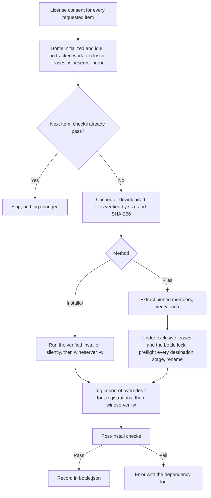

# Windows dependencies

[Documentation index](README.md) · [Runtime lifecycle](runtime-lifecycle.md)

Many games and launchers expect Microsoft runtimes that a fresh Wine prefix does not contain. MagicWine offers a small curated catalog, [`DependencyCatalog.swift`](../Sources/MagicWineCore/DependencyCatalog.swift), installed by [`DependencyInstaller.swift`](../Sources/MagicWineCore/DependencyInstaller.swift) and `WineRuntime.installDependencies`. It is not a general winetricks replacement: every entry is pinned, verified, and was installed and checked with the managed Wine 11 runtime.

## Catalog

| ID | Contents | Source (pinned) | Install method | Post-install check |
| --- | --- | --- | --- | --- |
| `vcrun2022-x64` | Visual C++ 2015–2022 Redistributable 14.44.35211 for 64-bit programs | `VC_redist.x64.exe` (25.6 MB) on download.visualstudio.microsoft.com, the target of Microsoft's versioned `aka.ms/vs/17/release/14.44.35211/` link | Microsoft installer with `/install /quiet /norestart`, then `native,builtin` overrides for its DLLs | Native (non-Wine) `system32` `vcruntime140`, `vcruntime140_1`, `msvcp140`, `concrt140`; every override present |
| `vcrun2022-x86` | The same release for 32-bit programs | `VC_redist.x86.exe` (14 MB), same origin | As above, in `syswow64`; no `vcruntime140_1` (x64 only) | Native `syswow64` `vcruntime140`, `msvcp140`, `concrt140`; overrides |
| `d3dcompiler_47` | D3DCompiler 47 6.3.9600.16384, 32- and 64-bit | Two Windows 8.1 SDK cabinets on download.microsoft.com (the files winetricks uses) | Extract one pinned member from each cabinet, place it as `syswow64`/`system32` `d3dcompiler_47.dll`, override `native` | Both DLLs native with the right PE machine; override present |
| `corefonts` | Andale Mono, Arial, Arial Black, Comic Sans MS, Courier New, Georgia, Impact, Times New Roman, Trebuchet MS, Verdana, Webdings | Microsoft's eleven original "core fonts for the Web" packages, mirrored at a fixed commit of `github.com/pushcx/corefonts` (winetricks' source; hashes match winetricks) | Extract the 30 TrueType files, place them lowercased in `windows/Fonts`, register each under both `HKLM\Software\Microsoft\Windows NT\CurrentVersion\Fonts` and `…\Windows\CurrentVersion\Fonts` as `<name> (TrueType)` | Every font file present and both registrations present |

Each download records URL, file name, size and SHA-256; each extracted file records its member name, size and SHA-256. Versioned URLs are used deliberately: `aka.ms/vs/17/release/vc_redist.x64.exe` changes content with every release and would break the pin. Updating an entry means downloading the new file, recording its hash and size, and checking it in a temporary bottle again.

Overrides go to `HKCU\Software\Wine\DllOverrides`, the persistent per-prefix load order winetricks also writes. A launch's `WINEDLLOVERRIDES` (see [launch layers](runtime-lifecycle.md#environment-synchronization-and-display)) still wins for any DLL it names; none of the launch layers name these DLLs.

## Licenses and consent

Each item is under its own license, not MagicWine's: the [Visual C++ Redistributable license terms](https://visualstudio.microsoft.com/license-terms/vs2022-cruntime/), the [Windows SDK license terms](https://learn.microsoft.com/en-us/legal/windows-sdk/license) (D3DCompiler 47 is redistributable code, see the [redist list](https://learn.microsoft.com/en-us/legal/windows-sdk/redist)), and the [TrueType core fonts for the Web EULA](https://github.com/pushcx/corefonts/blob/8f8627b0004b5f1b952c09cf6390e4ae46475e59/LICENSE). `installDependencies(_:in:acceptLicense:)` refuses without consent before downloading or creating anything; the GUI asks once per install with the license link, and the CLI requires `--accept-license`. The dependency log records which licenses were accepted.

## Download cache and verification

Downloads go to `Components/dependencies/<id>-<first 12 hex of SHA-256>/<file>` in the library root (so a CLI `--root` keeps its own cache). A download must end at an HTTPS URL with status 200–299, is moved into a private `.download-<UUID>` stage, and must match the pinned size and SHA-256 before it is published with an exclusive rename; a mismatch discards it and installs nothing. A cached file is hashed again on every use, including immediately before Wine executes an installer. A cached file that no longer matches is replaced by a fresh download; a symbolic link or other non-ordinary entry is refused. Cabinets are listed first and only the pinned plain member names are extracted with macOS `bsdtar` into a private `.extract-<UUID>` stage, then each member is checked against its own hash.

[Storage cleanup](runtime-lifecycle.md#reclaiming-storage) does not list this cache; delete `Components/dependencies` by hand to reclaim it (it is downloaded again when needed).

## Installation



The whole request is one bottle operation:

1. It refuses unknown IDs, missing consent, an uninitialized bottle, or a graphics/display/settings change in progress. Programs must not be running: it waits up to 15 seconds for a lingering wineserver to exit (without killing it), then takes the same exclusive launch/lifetime lease check and 0.5-second idle probe as synchronization changes. A running program fails the request with "Close this bottle's Windows programs or use Stop".
2. Items run in catalog order. An item whose checks already pass is skipped and reported as already present; MagicWine does not record it.
3. Installers run through the normal `WineRuntime` launch path with the bottle's own environment and integrations, so leases and Stop apply. Microsoft installers report states such as "restart required" with nonzero codes, so the exit code is logged and the post-install checks decide. After every Wine step MagicWine waits for the bottle's wineserver to exit, so installer children have finished and the registry is saved before anything is checked; if Windows processes are still running after 600 seconds, the bottle's Wine is stopped and the item fails.
4. File placement holds exclusive launch and lifetime leases (the bottle is idle again) and the bottle lock. Every destination is checked before anything changes: it must be absent, a Wine builtin/placeholder DLL of the expected machine, or already the pinned file. Anything else, for example a different native `d3dcompiler_47.dll` or font the user installed, stops the item with the prefix unchanged. New files are copied beside their destination, verified, and renamed into place, never written through an existing file or link.
5. Registry values are written as a REGEDIT4 file in `C:\windows\temp` and imported with Wine's `reg import`.
6. The item's post-install checks must pass. MagicWine then records `{id, version, installedAt}` in `bottle.json`'s `dependencies` array with `BottleStore.recordDependency` (older records decode with none; general `save` refuses to change it).

Stop during an installation cancels the operation: a download or extraction stops, Wine processes are interrupted, and the GUI shows it as stopped. Items already completed stay installed and recorded. There is no uninstall: Wine prefixes have no reliable way to remove an MSI runtime again; use a new bottle if needed.

Every run writes a `dependencies <ids>` summary log to the bottle's `Logs/Bottles/<bottle-UUID>/` folder (accepted licenses, verified URLs and hashes, installer exit codes with their own `dependency …` process logs, imported registry text, check results), held open while it runs so log retention keeps it; it appears in the bottle's log list and `logs <bottle-UUID>`, and `.started(logURL:)` progress delivers its path.

## Status

`WineRuntime.dependencyStatus(in:)` evaluates each item's checks against the prefix files without starting Wine: a native DLL is any PE image of the right machine without Wine's builtin/placeholder marker; registry checks read Wine's saved `user.reg`/`system.reg`, which a running Wine may write a little later. **Installed** means all checks pass, regardless of who installed it; a partial result (for example a deleted font) is shown as incomplete, and installing again repairs it. The `dependencies` record says only that MagicWine installed it and when.

| Entry point | Behavior |
| --- | --- |
| GUI **Dependencies…** in the dashboard **Tools** card | Sheet listing each item with version, architecture, download size, license link and status. **Install…**/**Repair…** shows the license and download origin; **Accept License and Install** starts the operation with download progress, then refreshes the status. **Show Log** opens the summary log in the log viewer while it runs and after a failure, which also shows inline; the dashboard Stop button applies. |
| CLI `deps <bottle-UUID>` | One line per item: ID, status, version, architecture, size, name; its license; missing checks when incomplete. |
| CLI `deps <bottle-UUID> install <id>… --accept-license` | Prints the log path and progress, then each item as installed or already installed. Without `--accept-license` it prints the licenses and exits with an error. |

For example:

```sh
CLI=./dist/magicwine
"$CLI" --root "$ROOT" deps "$BOTTLE"
"$CLI" --root "$ROOT" deps "$BOTTLE" install vcrun2022-x64 vcrun2022-x86 d3dcompiler_47 corefonts --accept-license
```

With the managed Wine 11 runtime, installing all four into a new temporary bottle took about 45 seconds once downloaded, and every post-install check passed.

## Not included: .NET Framework 4.8

.NET Framework 4.8 was tested and left out because it does not work reliably with the managed Wine 11 runtime. Following winetricks' `dotnet48` steps in a temporary bottle (remove Wine Mono with `uninstaller --remove`, delete its `mscoree.dll`, install .NET 4.0 under Windows XP with `fusion=b`, set Windows 7, install `ndp48-x86-x64-allos-enu.exe /q /norestart`, `mscoree=native`), both installers returned 0 in about three minutes and the registry reported release 528049. 32-bit managed programs then ran (`Framework\v4.0.30319\MSBuild.exe -version` printed 4.8.3761.0), but every 64-bit managed program crashed at startup (`Framework64\…\MSBuild.exe`: "internal error in the .NET Runtime", exit code 0x80131506, access violation in the CLR). On a 64-bit prefix, AnyCPU .NET programs (most of them) start as 64-bit, so they would fail. Winetricks itself warns that `dotnet40`/`dotnet48` are unreliable in 64-bit prefixes. The steps are also not reversible: Wine Mono, which already runs many .NET Framework programs, is removed. Keep Wine Mono, or use CrossOver for programs that need Microsoft's .NET Framework.
