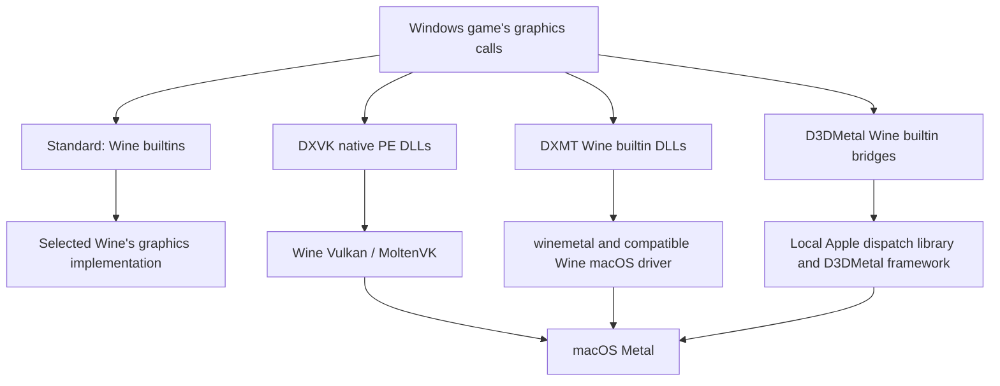
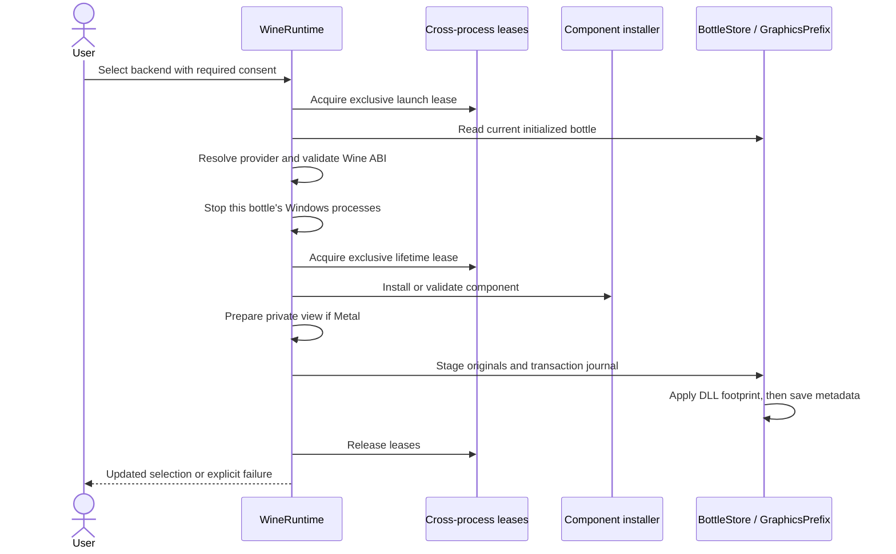

# Graphics backends and runtime views

[Documentation index](README.md) · [Runtime lifecycle](runtime-lifecycle.md) · [Compatibility patches](compatibility.md)

A bottle stores a graphics backend, component ID, and HUD preference. Selecting a backend changes a defined DLL footprint and launch environment; it does not replace the bottle's pinned Wine executable with another distribution.

## Rendering paths



| Backend | Intended Direct3D scope | Windows payload architectures | Payload origin |
| --- | --- | --- | --- |
| Standard | Whatever the selected Wine provides; no additional renderer selected | Determined by Wine | Bottle's Wine runtime |
| DXVK | 9, 10, 11; not 12 | 32-bit and 64-bit | Bundled altered macOS DXVK fork |
| DXMT | 10 and 11; not 9 or 12 | 32-bit and 64-bit | Bundled DXMT with matching remote-presentation changes |
| D3DMetal | 64-bit 11 and 12; no 32-bit bridge installed | 64-bit | Legally obtained local Apple libraries |

This is an implementation map, not a game-support matrix. Unsupported Direct3D features, anti-cheat, DRM, media, input, and launcher failures remain independent concerns. Standard does not promise a particular feature level. The DXVK fork leaves unsupported pipeline-statistics results unavailable rather than returning fabricated counters; a game waiting for those results can stall. Its D3D9 geometry support still depends on the Vulkan driver's capabilities.

Sources: [GraphicsModels.swift](../Sources/MagicWineCore/GraphicsModels.swift), [GraphicsComponentProvider.swift](../Sources/MagicWineCore/GraphicsComponentProvider.swift), [GraphicsPrefix.swift](../Sources/MagicWineCore/GraphicsPrefix.swift), [GraphicsSettingsView.swift](../Sources/MagicWine/GraphicsSettingsView.swift).

Each non-Standard backend is described by one `GraphicsComponentProvider` (DXVK, DXMT, D3DMetal): its current and supported component IDs, install and validation entry points, host/Wine runtime check, prefix DLL mappings, private-runtime-view substitutions, cache folder, and launch facts for the planner's graphics layer. Setup, launch, prefix transactions, runtime views, and storage cleanup look the provider up from the bottle's backend; see [architecture](architecture.md#adding-a-graphics-backend).

## Host and Wine requirements

The app's macOS 14 minimum does not mean every renderer has the same minimum.

- **DXVK:** the selected runtime must provide the expected `lib/libMoltenVK.dylib` and `lib/wine/x86_64-unix/winevulkan.so` layout. This existence check is not a GPU-feature certification.
- **DXMT:** macOS 15 or newer, a Metal device supporting the Apple7 family, and a compatible native x86_64 Wine loader/driver ABI. Validation inspects the macOS driver exports, `ntdll.so` linkage, and both Windows driver architectures, not just `wine --version`.
- **D3DMetal:** Apple Silicon, macOS 14 or newer, a compatible native x86_64 Wine loader, and a driver exposing the required Metal bridge ABI. Imported libraries can require a newer macOS deployment target, which is checked. Old DXMT-only bridge markers and mismatched native `ntdll`/driver pairs are rejected.

Rosetta is required for an Intel Wine loader on Apple Silicon. MagicWine does not install it or accept Apple's terms. An ordinary upstream Wine installation is not automatically compatible with the Metal backends. See [Compatibility patches](compatibility.md) for the bundled managed bridge.

Runtime validation and private-view construction have distinct checks. A wrapper, relocated loader, ambiguous `lib/wine` plus `lib64/wine` layout, or escaping symlink can fail private-view preparation even if an earlier ABI inspection succeeded. Prefer the native executable in the runtime's `bin` directory.

Sources: each provider's `validateRuntime` in [GraphicsComponentProvider.swift](../Sources/MagicWineCore/GraphicsComponentProvider.swift), which calls `validateRuntime` in [DXVKInstallation.swift](../Sources/MagicWineCore/DXVKInstallation.swift), [DXMTInstallation.swift](../Sources/MagicWineCore/DXMTInstallation.swift) and [D3DMetalInstallation.swift](../Sources/MagicWineCore/D3DMetalInstallation.swift).

## Component installation and integrity

Components live under the application root's `Components/` directory, separately from bottle prefixes.

### DXVK and DXMT

Installation uses bundled archives, not a fallback network download. The installers verify archive hashes, allowed archive entries, payload architectures, exact expected receipts, and component files before publishing a private staging directory. A competing installation is validated rather than overwritten. Invalid cached content fails explicitly.

**Component layout.** An installed component holds the extracted payload, its license/notice files, provenance, and `installation.json`. It does not copy archives the app bundle already ships. The current DXMT component, `dxmt-v0.80-remote.1-slim`, installs the `dxmt-v0.80-remote.1` build:

```text
Components/dxmt-v0.80-remote.1-slim/
  i386-windows/  x86_64-windows/  x86_64-unix/        pinned payload
  LICENSE-DXMT.txt                                    license and dependency notices
  dxmt-v0.80-remote.1-provenance.json  PROVENANCE.txt build provenance
  installation.json                                   schema 3 receipt
```

The altered archive `dxmt-v0.80-remote.1.tar.gz`, its complete corresponding source `dxmt-v0.80-remote.1-source.tar.gz`, and the original upstream release `dxmt-v0.80-builtin.tar.gz` stay in the resource bundle (`MagicWine_MagicWineCore.bundle/Contents/Resources/`, see [THIRD_PARTY_NOTICES.md](../THIRD_PARTY_NOTICES.md)). The receipt lists them as `bundledArchives` (name → SHA-256) and `PROVENANCE.txt` names each with its SHA-256 and location, so the component identifies its corresponding source exactly. Installation verifies that the bundle ships those archives with the pinned bytes before it records them. The receipt pins the license, provenance, and `bundledArchives` like the payload, so a missing or changed notice, a dropped or redirected source reference, or an added archive copy fails validation. Compared with the previous layout, a fresh DXMT component measures 49 MB instead of 168 MB (`du -sh`).

The earlier `dxmt-v0.80-remote.1` component (schema 2) has the same payload plus copies of those three archives. It remains a retained component with its own literal receipt. Existing bottles keep launching from it unchanged until they are updated in place. The slim layout has its own component ID rather than a second accepted receipt under the old ID for three reasons. Each component ID keeps naming exactly one pinned file inventory. Existing libraries can reclaim the copies: `--update` moves bottles to the slim component, then [storage cleanup](runtime-lifecycle.md#reclaiming-storage) finds the old component and its private runtime view unused. Runtime view identities and cleanup reachability keep following `Components/<ID>` without special cases.

DXVK never copied its bundled archive into the component, so its layout and ID are unchanged. The managed Wine runtime's driver backup follows the same rule; see [Runtime lifecycle](runtime-lifecycle.md).

**Retained older components.** Besides its current component, a provider can list older component IDs whose installer still holds their own receipt and pins: DXMT retains the historical `dxmt-v0.80` and the archive-copying `dxmt-v0.80-remote.1`, DXVK currently retains none. A bottle pinned to a retained component keeps launching with exactly those bytes (validated against that component's pins, never relabelled as the current one) and can be updated in place; see [Updating a component in place](#updating-a-component-in-place). Any other old or unknown component ID (for example an earlier `dxvk-macos-1.10.3-magicwine.1`) is unsupported: it neither launches nor updates, and choosing Standard restores the bottle's original files. When a pin is bumped, moving the outgoing receipt into the retained list (as a literal) keeps existing bottles launchable, provided the backend's prefix footprint did not change.

Integrity checks use independently compiled expectations. A receipt cannot make its own altered payload trustworthy. File-stamp caches avoid repeated hashing of unchanged validated components. Quarantine is preserved for graphics payload copies, unlike the separately consented managed-Wine quarantine removal.

Pin ownership:

- [DXVKBuildPins.swift](../Sources/MagicWineCore/DXVKBuildPins.swift) (generated by `scripts/build-dxvk.sh`): DXVK version/component ID, archive, source commit, dependency notice, and payload hashes; [DXVKInstallation.swift](../Sources/MagicWineCore/DXVKInstallation.swift) holds the receipt and attribution texts built from them.
- [DXMTRemoteBuildPins.swift](../Sources/MagicWineCore/DXMTRemoteBuildPins.swift) (generated by `scripts/build-dxmt.sh`): altered DXMT component ID, archive, corresponding source, provenance, upstream archive/license digests, and payload hashes.
- [DXMTInstallation.swift](../Sources/MagicWineCore/DXMTInstallation.swift): receipt construction and historical-component expectations.
- [WineMetalBuildPins.swift](../Sources/MagicWineCore/WineMetalBuildPins.swift) (generated by `scripts/build-metal-wine.sh`) feeds [WineMetalDriver.swift](../Sources/MagicWineCore/WineMetalDriver.swift): the separate managed Wine runtime modules, not the DXMT renderer.

The generated pins files, how they are produced and adopted, and the test that recomputes every resource hash are described in [Development](development.md#generated-pins).

### D3DMetal imports

Discovery searches beside the selected/resolved Wine installation, then installed CrossOver locations. Discovery only finds a candidate; it does not establish integrity, compatibility, or permission to use the libraries.

An explicit import may select the directory containing `external/` and `wine/`, or a supported parent containing `redist/lib` or `lib`. The importer requires the shared dispatch library, complete D3DMetal framework and notices, and matching Windows/Unix bridge files. It validates architectures, minimum OS versions, paths, file types, sizes, supported aliases, and complete optional module pairs. Expanded copies of Unix bridge aliases must match the canonical shared library's bytes.

Files and notices are copied with quarantine preserved. Input and staged inventories are checked again to detect changes during import. The resulting `d3dmetal-<digest>` directory is content-addressed by a canonical receipt. **That digest identifies the user's supplied bytes; it is not an upstream authenticity pin.**

MagicWine neither downloads nor licenses these proprietary libraries. Consent in the app is not acceptance of Apple's or CodeWeavers' terms. Optional imported vendor modules are not automatically enabled by the selected runtime view.

Source: [D3DMetalInstallation.swift](../Sources/MagicWineCore/D3DMetalInstallation.swift).

## Switching a bottle safely



A failure after the stop step can leave applications stopped even when the graphics selection remains unchanged. The native dashboard gates backend selection while it considers the bottle busy/running; direct CLI/core graphics reconfiguration explicitly stops its processes. Save game state first. Changing only the HUD is not a reconfiguration; see [Launch overrides, HUD, and display](#launch-overrides-hud-and-display).

Three forms of coordination serve different lifetimes:

- **Launch lease:** excludes setup from the launch handoff until the Windows process has started.
- **Lifetime lease:** shared by executing operations, exclusive during setup after processes are stopped.
- **Prefix/metadata lock:** serializes short filesystem changes and transaction recovery.

Lease files are under `Bottles/.graphics-locks/`; locks are cross-process, cancellation-aware, and use validated ordinary files. They coordinate MagicWine processes, not arbitrary manual changes or external tools ignoring the locks.

### Original files and crash recovery

`graphics/active/` under the bottle records the selected footprint and preserved originals. An original can be a file, symlink, or absence. Direct backend switches retain pre-renderer originals for overlapping paths, capture newly affected paths, and restore paths no longer owned by the next backend.

`graphics/transaction/` records before/after snapshots and the exact previous/next bottle metadata. The journal is published before prefix mutation. Recovery on a locked read follows saved metadata:

- Previous metadata: restore the before snapshot.
- Next metadata: the change committed; finish cleanup.
- Neither: stop and retain recovery evidence rather than guessing.

If a user or installer replaces a managed DLL, switching/restoring preserves displaced content under `graphics/recovered/<UUID>/` instead of discarding it. Missing or inconsistent backups are errors. Do not delete journals or manifests as a repair strategy.

Selecting Standard restores the original footprint without needing the old graphics component to remain installed. A HUD-only change never recaptures or reinstalls prefix DLLs and does not stop processes (see below). A different component of the same backend is only accepted through the explicit update below; unsupported components require restoring Standard first.

**Validation boundary:** launch-time prefix validation checks the active manifest, paths, regular-file layout, and expected DLL sizes; it does not hash every prefix DLL on every launch. Component validation and transaction preservation use stronger hash checks. Do not treat the prefix check as tamper-proofing.

### Updating a component in place

When a bottle uses a retained older component (`GraphicsConfiguration.hasComponentUpdate`), the dashboard shows **Update <backend> component** with an explanation, and the CLI offers `graphics <bottle-UUID> <current-backend> --update --accept-experimental` (`graphics <bottle-UUID>` prints a note on stderr when an update is available). `WineRuntime.updateGraphicsComponent(in:acceptExperimental:)` follows the same consent, lease, and stop rules as a backend switch:

1. Acquire the exclusive launch lease, re-read the bottle, and refuse an unsupported component (restore Standard instead), an imported D3DMetal component (no newer version exists; import again after Standard), or a stale backend. A bottle already on the current component is returned unchanged.
2. Validate the Wine runtime, stop the bottle's Windows processes, and acquire the exclusive lifetime lease.
3. Install or verify the current component and, for Metal backends, prepare its private runtime view.
4. In one `GraphicsPrefix` transaction, replace the backend's DLLs with the new component's while carrying the pre-renderer originals over unchanged, preserve user-replaced DLLs under `graphics/recovered/`, and commit the new component ID in `bottle.json`. The journal records both component IDs, so an interrupted update recovers to the old or the new selection exactly like a backend switch.

The HUD preference is kept. The old component stays in `Components/` until [storage cleanup](runtime-lifecycle.md#reclaiming-storage) finds no bottle using it (along with its now-unused runtime view).

Sources: [GraphicsOperationLease.swift](../Sources/MagicWineCore/GraphicsOperationLease.swift), [GraphicsPrefix.swift](../Sources/MagicWineCore/GraphicsPrefix.swift), [BottleStore.swift](../Sources/MagicWineCore/BottleStore.swift), `updateGraphicsComponent` in [WineRuntime.swift](../Sources/MagicWineCore/WineRuntime.swift).

## Why Metal needs a private runtime view

Wine resolves builtin DLL paths relative to the real path of `ntdll.so` before `WINEDLLPATH`. Copying only Windows PE files into a prefix cannot reliably select a renderer with Unix-side modules.

[GraphicsRuntimeView.swift](../Sources/MagicWineCore/GraphicsRuntimeView.swift) builds a validated view at:

```text
Runtimes/.graphics-views/<receipt-digest>/
```

The identity depends on the runtime, component, backend, and recorded source inventory. Views belong to the application data root and may be reused by bottles with the same inputs; they are not stored inside a bottle. A changed input produces a new view and leaves the old one in place until [storage cleanup](runtime-lifecycle.md#reclaiming-storage) removes views that no bottle's current inputs produce.

The view copies unchanged native loaders and Unix modules where real-path or `@loader_path` resolution matters, links other runtime entries, and overlays the selected graphics modules. Loader aliases and the `ntdll`-relative child loader stay inside the view so `CreateProcess` does not escape back to the original renderer.

For DXMT, the native `winemetal.so` copy resolves the compatible Wine driver inside the view. For D3DMetal, Unix aliases point to one canonical `libd3dshared.dylib`, preserving shared dispatch state and framework lookup. The importer verifies those aliases rather than loading independent expanded copies.

The receipt records copies, hashes, links and target metadata, and directories. Reuse validates the exact tree and receipt; a corrupted view is rejected rather than repaired in place. Native copies preserve executable permissions, signatures, extended attributes, and quarantine. The original Wine installation is not rewritten or re-signed by graphics setup.

Launch uses the private executable and `WINELOADER`, but `WINESERVER` remains the server from the bottle's original pinned runtime. Standard and DXVK do not require these views.

## Launch overrides, HUD, and display

| Backend | Important process-local policy |
| --- | --- |
| Standard | No additional graphics component or managed graphics HUD |
| DXVK | Native `d3d9,d3d10core,d3d11`; builtin `dxgi`; `WINE_D3D_CONFIG=renderer=vulkan` even with HUD off |
| DXMT | Builtin `d3d10core,d3d11,dxgi,winemetal` from the selected component/view |
| D3DMetal | Builtin `d3d11,d3d12,dxgi` with the local shared library/framework |

DXVK uses `DXVK_HUD`; Metal backends use `MTL_HUD_ENABLED`. HUD is not the renderer-selection mechanism. Because the HUD is only launch environment, `WineRuntime.setGraphicsHUD(_:in:)` changes just `graphics.showHUD` in `bottle.json` (via `BottleStore`, under the bottle lock): it never stops Windows processes, touches prefix DLLs, or re-verifies the component, and it is allowed while programs run. The change applies to programs launched afterwards; running programs keep their current overlay. It refuses Standard, an unsupported component (a retained older one is allowed), and a caller whose view of the backend/component is stale, and it cannot overlap another graphics/display/synchronization change of the same bottle. The dashboard's **Show Graphics HUD** toggle uses this path and stays enabled while programs run. **Retina / HiDPI** is a separate bottle-wide Wine setting: enabled uses Retina mode and 192 DPI; disabled uses non-Retina mode and 96 DPI. It can change the resolution a game chooses and therefore GPU load. **MSync** is also independent of the renderer; see [Compatibility patches](compatibility.md).

What DXVK's overlay shows is the bottle's **DXVK HUD** compatibility switch (Runtime card → **Advanced compatibility**, or `compat <bottle-UUID> --dxvk-hud fps|detailed`): Detailed (default, `DXVK_HUD=version,api,devinfo,fps,frametimes`) or Frame rate only (`DXVK_HUD=fps`). It is applied in the bottle-settings launch layer only while DXVK and Show Graphics HUD are both on, is metadata only like the HUD toggle, and a program's own `DXVK_HUD` variable wins over it. Metal backends keep their on/off `MTL_HUD_ENABLED`.

Inherited loader/graphics variables are deliberately sanitized by the launch planner's base layer. Setting `DXVK_*`, `DXMT_*`, `D3DM_*`, `MTL_*`, or `DYLD_*` in the launching shell is not a supported way to bypass managed configuration. The backend layer sits above controller/CPU integrations: if both name the same DLL or variable, the backend's value is used (see [runtime lifecycle](runtime-lifecycle.md#environment-synchronization-and-display)).

DXVK cache files live in the bottle's `graphics/cache/`; DXMT shader cache files use `graphics/dxmt-cache/`. Logs use `Logs/Bottles/<bottle-UUID>/dxvk/` or `Logs/Bottles/<bottle-UUID>/dxmt/` (older versions used `Logs/<bottle-UUID>-dxvk/` and `-dxmt/`, which stay in place). This code does not establish an equivalent D3DMetal-specific log/cache directory. Symlinked graphics cache/log directories are rejected.

Source: `prepareGraphicsLaunch` in [WineRuntime.swift](../Sources/MagicWineCore/WineRuntime.swift) (validation, folders, runtime view), each provider's `launchFacts` and `cacheFolder` in [GraphicsComponentProvider.swift](../Sources/MagicWineCore/GraphicsComponentProvider.swift), and the graphics layer in [LaunchPlanner.swift](../Sources/MagicWineCore/LaunchPlanner.swift) (variables and DLL overrides).

## CLI examples

Run from the checkout after building. Set `ROOT` to your isolated application data root and `BOTTLE` to a UUID printed by `list`. Backend selections change the selected bottle and may stop its Windows processes; a HUD-only change does not.

```sh
CLI="$PWD/dist/magicwine"
ROOT="$PWD/.local/graphics-research"
# Use an existing bottle UUID from: "$CLI" --root "$ROOT" list
BOTTLE="<bottle-UUID>"

"$CLI" --root "$ROOT" graphics "$BOTTLE"
"$CLI" --root "$ROOT" graphics "$BOTTLE" dxvk --accept-experimental --hud
"$CLI" --root "$ROOT" graphics "$BOTTLE" dxmt --accept-experimental --no-hud
"$CLI" --root "$ROOT" graphics "$BOTTLE" d3dmetal --accept-experimental --import "/absolute/path/to/library-folder"
"$CLI" --root "$ROOT" graphics "$BOTTLE" dxmt --update --accept-experimental
"$CLI" --root "$ROOT" graphics "$BOTTLE" standard
```

Run only the relevant selection command, not the whole sequence as a test. Selecting or re-verifying a nonstandard backend requires `--accept-experimental`. Repeating the bottle's **current** backend with `--hud` or `--no-hud` (and no `--import`) only saves the HUD preference for later launches: it needs no `--accept-experimental` and does not stop running programs. Omitting HUD flags preserves the prior HUD setting; Standard clears it and accepts no flags. `--update` (with `--accept-experimental`, on the bottle's current backend, without HUD or import flags) switches a retained older component to the bundled one in place; it stops the bottle's Windows processes and prints the new selection. A different D3DMetal import requires switching to Standard first. `--hud` and `--no-hud` are mutually exclusive; `--import` is D3DMetal-only.

For backend smoke probes, visual evidence, and missing-component recovery guidance, see [Debugging](debugging.md) and [Development](development.md).
