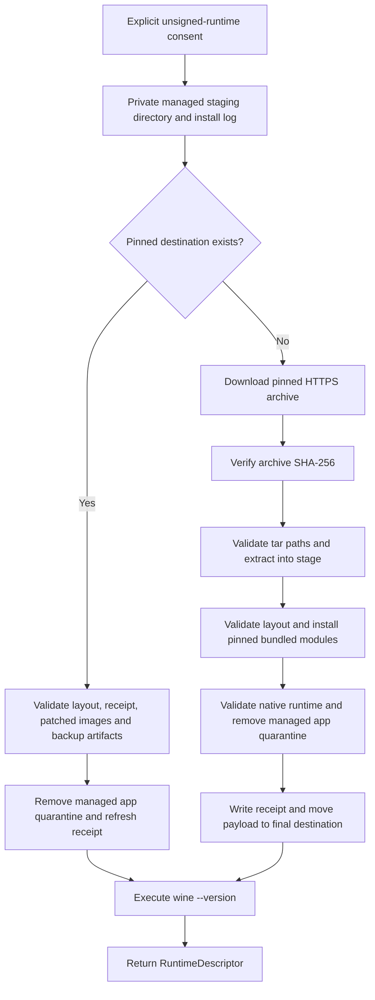
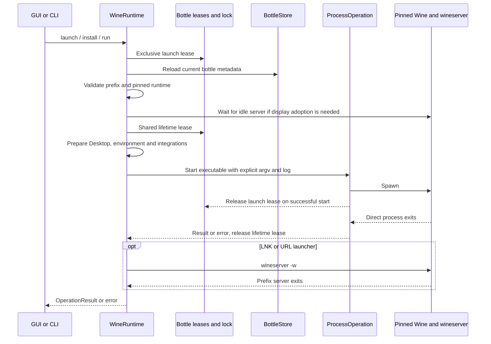

# Runtime and bottle lifecycle

[Documentation index](README.md) · [Architecture](architecture.md)

The controlling implementation is [`WineRuntime.swift`](../Sources/MagicWineCore/WineRuntime.swift). A runtime install, a default-runtime preference, a bottle's pinned runtime, and a running Wine server are four different pieces of state. Keeping them separate prevents an app update or a changed `PATH` from silently migrating existing prefixes.

## Managed installation: consent before executable content

The current managed runtime combines Gcenx Wine `11.0_1` with bundled `winemac-wine11.0-metal.7` modules and matching `wineserver`. [`RuntimeInstallation.swift`](../Sources/MagicWineCore/RuntimeInstallation.swift) pins:

- Source: `https://github.com/Gcenx/macOS_Wine_builds/releases/download/11.0_1/wine-stable-11.0_1-osx64.tar.xz`
- Archive SHA-256: `b50dc50ec7f41d58b115a6b685d4d1315ba3c797bd3aa0f49213f2703cb82388`
- Destination relative to the library: `Runtimes/wine-11.0_1-b50dc50ec7f4-winemac-wine11.0-metal.7/`
- Executable beneath that destination: `Wine Stable.app/Contents/Resources/wine/bin/wine`

These identifiers describe this implementation, not a rolling latest-release lookup. The patch revision participates in the destination name so older pinned bottles can retain their old runtime.



`installRuntime(acceptUnsigned:)` rejects absent consent and rejects another install already active in that `WineRuntime` actor. The GUI obtains confirmation before calling it; the CLI requires exactly `install-wine --accept-unsigned`. Consent covers unsigned Wine and bundled modules plus narrowly scoped quarantine removal. It is not malware certification, notarization, or license acceptance for separately obtained Apple libraries.

### Download and publication invariants

1. Prepare the library and a mode-0600 installation log. Create `.install-<UUID>` with mode 0700 under `Runtimes`; remove it on normal return or error.
2. Download with a 600-second request timeout and require an HTTPS final response with HTTP status 200–299. [`RuntimeDownload`](../Sources/MagicWineCore/RuntimeDownload.swift) uses a file download, not an in-memory response body. With a progress callback it owns an ephemeral session and delegate, moves Foundation's temporary file before the delegate returns, samples byte-rate updates at roughly 0.25-second cadence, and propagates cancellation. Without progress it uses `URLSession.shared.download`.
3. Hash in 1 MiB chunks in a cancellable utility task. The 2 GiB limit is enforced during hashing, **not** as a streaming network quota. Reject a digest mismatch before extracting or publishing anything.
4. List the archive first. Every entry must be relative, contain neither backslashes nor `..` components, and belong to `Wine Stable.app`. Extract with `/usr/bin/tar --no-same-owner --no-same-permissions`; the implementation relies on macOS bsdtar's default link-traversal protections as well as subsequent containment validation.
5. Validate the complete managed layout before changing it. [`WineMetalDriver`](../Sources/MagicWineCore/WineMetalDriver.swift) validates bundled compressed/source/license/provenance digests and original runtime images, retains originals, and publishes decompressed replacements into this fresh private tree only. Validate the native runtime before publication.
6. Validate the bundle before quarantine removal. Only regular files/directories inside the managed `Wine Stable.app` are targets; contained symbolic links are not followed for attribute removal. Root/directory and containment checks reject escaping links and unsupported filesystem entries. `removexattr(..., XATTR_NOFOLLOW)` removes only `com.apple.quarantine`; no system-wide security setting changes.
7. Write `installation.json`, then move the payload to its content/version-named destination. Inspect `wine --version` afterward, with a 15-second timeout, to produce the descriptor.

Failures leave a diagnostic log and remove the private stage/download where owned. Publication happens before version inspection, so a later inspection/Rosetta/Gatekeeper failure can leave an installed destination for a subsequent consented retry. There is no automatic downgrade or fallback to an unrelated Wine. The install guard is per actor, not a global installation lock: concurrent independent installers can both stage work, but a final-destination collision fails rather than intentionally merging their trees.

### Cache reuse is validation, not blind receipt trust

An existing destination is not simply overwritten. Reuse requires the exact current destination, ordinary managed directory ancestry, a valid contained app layout, executable `wine` and `wineserver`, and an ordinary receipt whose source/archive hash/version/driver ID match the compiled pins. Patched image hashes, executable server, and the exact original/source/license/provenance backup set are checked against compiled-in digests; native-runtime validation also runs. Writable receipt values do not supply the trust roots.

This is not a complete rehash of every upstream file on every launch. `validateCachedRuntime` is used for cache reuse and explicit adoption, whereas normal execution validates the pinned executable and launch-specific requirements. A corrupt cache fails validation rather than being silently repaired in place. Reuse after new consent can remove quarantine again and refresh the receipt; explicit bottle upgrade uses the read-only validation path and does not alter trust attributes.

## Discovery, preference, and explicit adoption

Discovery searches the current managed destination, Wine Stable/Devel/Staging app layouts in system and user Applications, and common Homebrew paths under `/opt/homebrew` and `/usr/local`. Candidates are canonicalized and deduplicated, must be executable, and must report a Wine version. Automatic discovery excludes known CrossOver/Whisky runtime paths, including resolved Homebrew aliases. That exclusion is an automatic-discovery policy, not a sandbox or blanket rejection of every explicitly selected executable.

Only the current managed runtime is an automatic default. An explicitly saved external preference may select external Wine; a preference pointing to an older managed directory does not make that old revision the automatic default. The GUI can inspect a selected native Wine executable and save its custom/preferred path. Inspection actually executes `--version`: do not inspect an executable you do not trust.

Each bottle pins its own executable URL and version. Installing new Wine or changing the GUI preference does not rewrite existing bottles. On launch, a missing pinned Wine or adjacent `wineserver` is an error; `PATH` is not consulted as a replacement.

Explicit upgrade is narrowly supported for old managed Metal revisions `.1` through `.6` with the current upstream archive identity. It is not a migration mechanism for arbitrary custom Wine. Upgrade requires an idle bottle, an installed and validated current managed runtime, graphics-backend compatibility, and successful version inspection before saving the new descriptor. It does not rerun `wineboot`, download Wine, or remove quarantine.

| Entry point | Behavior |
| --- | --- |
| GUI general **Install / Update Wine** | Obtain consent, install/reuse, add the runtime to the UI list, save it as the preferred runtime for future selection; existing bottle pins remain unchanged. |
| GUI bottle **Update Wine** | Obtain consent, install/reuse, then explicitly adopt for the eligible selected bottle. Installation can succeed even if adoption subsequently fails. |
| CLI `install-wine --accept-unsigned` | Install/reuse and print version/path; does not save the GUI preferred-runtime setting or migrate bottles. |
| CLI `runtime upgrade <bottle-UUID>` | Adopt an already installed current runtime for an eligible idle old managed bottle; no implicit installation or consent. |

For example, from the repository root after building the app/CLI:

```sh
ROOT="$PWD/.local/runtime-research"
BOTTLE="<bottle-UUID>"
./dist/magicwine --root "$ROOT" install-wine --accept-unsigned
./dist/magicwine --root "$ROOT" runtime upgrade "$BOTTLE"
```

Replace `BOTTLE` with an eligible idle bottle UUID in that library. Installation runs third-party code after explicit consent; adoption is a separate operation. See [development](development.md) for packaging and [debugging](debugging.md) for creating an isolated bottle.

## Creating and initializing a bottle

`BottleStore.create` makes a UUID-named directory and empty `prefix`, then atomically writes `bottle.json` with `isInitialized = false`. If the first metadata write fails, it removes the newly created directory. The GUI selects the new bottle and starts setup; CLI `create <name> <wine-executable>` first inspects that executable and prints the new bottle UUID before setup.

Initialization executes `wineboot -u`, then the pinned adjacent `wineserver -w`, within an overall 180-second budget. The remaining time after wineboot is used for the server wait. `system.reg` and `user.reg` must exist afterward. The GUI/CLI caller, not `WineRuntime.initialize`, then sets and saves `isInitialized = true`. If setup fails, the bottle remains available for **Retry Setup** / `initialize <bottle-UUID>` rather than being silently deleted. The initialization flag is management metadata, not proof that every Windows component or application works.

EXE installers run directly; MSI installers use `msiexec /i`. After successful installer completion, GUI and CLI discover launchers. Installer return does not certify that every detached installer child has exited or that the application is compatible.

## Launch preparation and ownership handoff



Non-server operations take an exclusive **launch lease** before reading fresh metadata. This closes the metadata-to-spawn race against configuration. Pending lease tasks are registered so Stop can cancel a launch even before a `ProcessOperation` exists. Cancellation/settings checks repeat after suspension points, including controller preparation.

A shared **lifetime lease** covers the directly observed non-server process. Multiple programs may coexist after each has released its launch lease on spawn. Configuration takes exclusive leases when it needs all prior process lifetimes to end. Lock descriptors are close-on-exec and are not a lifetime tracker for detached descendants; this is why server probes remain necessary. Server commands bypass non-server launch preparation to allow stop/wait operations while mutation holds the launch lease.

Preparation reloads metadata, validates the prefix's exact UUID-owned location, checks the pinned Wine and matching server, and handles display adoption while Wine is idle. It prepares a real Desktop under the bottle lock. For initialized bottles it prepares controller integration and the applicable Rosetta/WoW64 repair; non-Standard graphics additionally validates the pinned component and installed prefix files and selects its launch environment/runtime view. Details belong to [controllers](controllers.md), [compatibility](compatibility.md), and [graphics](graphics.md).

Controller integration (profile service plus XInput bridge) and the Rosetta/WoW64 repair are **optional**: a failure such as an unreadable profile file, a custom or invalid `xinput*.dll`, a damaged backup, or a custom `wow64cpu.dll` skips only that component and the program still launches. Both prefix steps check for custom DLLs and validate backups before changing anything and replace DLLs only through atomic renames, so a refusal leaves the prefix DLLs as they were (at most a complete, verified original backup remains and is reused later). The load order stays deterministic: a skipped bridge forces Wine's builtin XInput (`xinput1_1,xinput1_2,xinput1_3,xinput1_4,xinput9_1_0=b`) and exports no `MAGICWINE_GAMEPAD_STATE`; a skipped CPU repair adds no `wow64cpu` override, so Wine's builtin module loads. A controller service failure also skips the bridge without touching the prefix. Cancellation and Stop still abort the launch. Graphics validation is not optional: a broken renderer selection still fails the launch.

Skipped components produce human-readable warnings that are written below the command line at the top of the process log and delivered through `launch(_:in:onStart:)` / `run(arguments:in:timeout:onStart:)` as a `LaunchStart` (log URL plus warnings) as soon as the process starts, not when it exits. The dashboard shows them as a dismissible notice with **Reveal Log** for that launch; CLI `launch` and `exec` print `warning: …` lines to stderr immediately.

An EXE launches with its containing directory as working directory. LNK/URL files use `wine start /unix <path>`, then wait on `wineserver -w` instead of trusting ShellExecute's asynchronous shortcut handle. `run(arguments:)` and `winecfg` use the prefix as their default working directory. Arguments are passed as an array, not interpolated into a shell command.

## Environment, synchronization, and display

Side effects (Desktop, display adoption, prefix DLL repairs, component validation, graphics folders, private runtime views, leases) stay in `WineRuntime`. It then hands only facts to the pure [`LaunchPlanner`](../Sources/MagicWineCore/LaunchPlanner.swift), which returns the exact executable, arguments, environment, working directory, and warnings, and `execute` runs that plan. The planner applies layers in a fixed order, lowest to highest, where a higher layer wins per variable and per DLL:

1. **Managed base defaults:** start with the parent's environment minus inherited Wine/loader (`WINE*`), `DYLD_*`, DXVK/DXMT/D3DMetal (`DXVK_*`, `DXMT_*`, `D3DM_*`, `CX_APPLEGPTK_LIBD3DSHARED_PATH`), Metal (`MTL_*`), and controller (`MAGICWINE_GAMEPAD_*`) settings; external Wine keeps inherited `WINEMSYNC`/`WINEESYNC`/`WINEFSYNC`. Prepend the pinned runtime's `bin` to `PATH`, supply `WINEPREFIX`, `shdocvw=n,b`, managed synchronization, and the Mono TLS correction.
2. **Compatibility integrations:** `wow64cpu=n`, the XInput bridge (`=n,b`) or forced builtin XInput (`=b`), and the controller session variable.
3. **Graphics backend:** the backend's DLL overrides and variables, and for Metal backends the private loader as executable plus `WINELOADER`/`WINESERVER`.
4. **Bottle settings**, then 5. **program settings** as the highest layer; both are reserved for per-bottle and per-program launch options and currently contribute nothing.

Server operations (`wineserver -k/-w`) and version inspection use only the base layer.

`WINEDLLOVERRIDES` is never concatenated. Every layer contributes a typed [`DLLOverrides`](../Sources/MagicWineCore/DLLOverrides.swift) value (ordered DLL names with mode `n`, `b`, `n,b`, `b,n`, or disabled); setting a DLL a lower layer already named replaces its mode in place, so duplicate keys, which Wine itself resolves in no documented order, cannot occur. The result is serialized once, with adjacent DLLs of the same mode sharing a segment, for example `shdocvw=n,b;wow64cpu=n;xinput1_1,…,xinput9_1_0=n,b;d3d9,d3d10core,d3d11=n;dxgi=b` for DXVK. This is not a minimal environment or a security boundary.

For the current managed runtime, capability is identified by canonical executable location, not its reported version string. MagicWine sets `WINEMSYNC` from bottle metadata (default `1`) and forces `WINEESYNC=0` and `WINEFSYNC=0`. External Wine retains inherited values for those three synchronization switches; MagicWine does not claim to own its policy. Older pinned managed Metal runtimes receive the Mono fallback-TLS correction but do not gain current-runtime MSync capability merely from a matching version label. See [compatibility](compatibility.md) for the underlying runtime changes.

Mutation semantics intentionally differ:

| Operation | Running-bottle behavior |
| --- | --- |
| Synchronization change or runtime adoption | Reject tracked/pending work, acquire exclusive launch/lifetime leases without waiting, then probe `wineserver -w` for 0.5 seconds. A live detached server causes failure; it is not killed just to change this preference. |
| Explicit Retina/display change | Requires initialization, holds exclusive launch intent, calls stop/wait, then obtains exclusive lifetime ownership before modifying registry and metadata. CLI can therefore stop a live bottle; GUI usually gates the action while its own launches are recorded. An already matching configuration needs no stop. |
| Automatic display adoption before launch | Waits for idle ownership and server exit; never kills existing Wine solely to adopt display defaults. Failure asks the user to close programs or use Stop. |
| Graphics configuration | Stops the bottle before changing graphics files under exclusive ownership; see [graphics](graphics.md) for transactions and component rules. |
| Graphics HUD only | Metadata-only `setGraphicsHUD`: allowed while programs run, never stops processes or touches prefix DLLs, applies to later launches. During its brief metadata write it excludes other setting changes of the same bottle, and a launch starting in that instant is refused with the usual "wait for setup" error. |

Retina on means 192 DPI / 200%; off means 96 DPI / 100%, bottle-wide, including games. `BottleStore.prepareDisplay` retains the previous registry bytes and restores them if saving metadata fails. General `BottleStore.save` rejects attempts to bypass the dedicated runtime/display/graphics/synchronization APIs.

## Stop, cancellation, failures, and deletion

Stop is prefix-scoped, not a global kill of all Wine installations:

1. Cancel registered pending launches and interrupt tracked processes.
2. Acquire exclusive launch ownership to prevent a preparation/spawn handoff during stopping.
3. Execute the pinned `wineserver -k` with a 15-second timeout, then `wineserver -w` with a 15-second timeout.
4. Acquire and release exclusive lifetime ownership with a 15-second timeout before reporting completion.

`wineserver -k` status 1 is tolerated only provisionally: `-w` must still establish the stopped postcondition. This handles an absent server without treating every status 1 as success. The server operation also reaches detached Windows children that outlived the direct launcher or were started by another frontend using the same prefix. Failure to validate the pinned runtime or reach the stopped state is surfaced, not replaced with an unrelated server executable.

`ProcessOperation` writes a command header and combined stdout/stderr to a mode-0600 log, supplies null stdin, and resumes its continuation once. For initialization, installers, `winecfg`, `run`/`exec`, server operations, and the `start /unix` dispatch of LNK/URL launchers, a nonzero exit is `processFailed` with exit code and log URL; for shortcuts it means Wine could not dispatch the target. A **direct EXE launch** instead returns its exit status in `OperationResult.exitCode`: games and launchers often quit normally with a nonzero code, so that is data, not a failure. The Unix status carries only the low 8 bits of the Windows exit code (`exit 300` reports 44). Termination by a signal remains `processFailed`. Cancellation, Stop, and timeouts interrupt the direct child with termination followed by `SIGKILL` after two seconds if needed. Tracked task cancellation/timeouts also run best-effort prefix cleanup in a detached Swift task, so cancellation of the initiating task does not suppress cleanup. A process exit alone cannot establish the entire Windows process tree is gone; Stop's explicit server wait is stronger.

The GUI treats a deliberate `stopped` error as a log event rather than an application failure. A program that exits with a nonzero code produces a dismissible, non-error notice "<program> exited with code N" for its bottle, with a short summary (the last few Wine `err:` lines from at most the final 64 KiB of that launch's log, via `ProcessLogSummary`) and **Reveal Log** for that specific log; a zero exit shows nothing new. Other errors remain visible. CLI errors go to stderr and exit status 1, except that `launch` prints `Exit code: N` and exits with N, and `exec` prints the log and exits with Wine's own status. Logs and failure interpretation are covered in [debugging](debugging.md).

**Trash Bottle** first calls `wine.stop`, then `BottleStore.delete` validates ownership under the bottle lock and moves the UUID directory to macOS Trash. It is not a permanent recursive delete and does not delete external registered executables, shared runtimes, or the separate library Logs directory. Removing one launcher only edits metadata. `BottleStore.delete` itself does not stop Wine: callers must respect that precondition. Stop and deletion are sequential operations rather than one global cross-process transaction, so avoid racing another frontend's launch against deletion. The current CLI exposes Stop but no bottle-delete command.

For trust boundaries and filesystem ownership, return to [architecture](architecture.md). For backend-specific limitations and diagnostics, continue with [graphics](graphics.md), [compatibility](compatibility.md), and [debugging](debugging.md).
